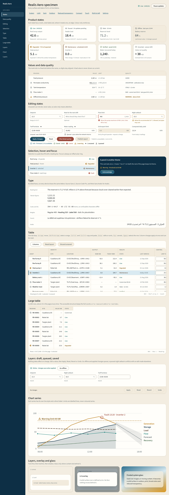
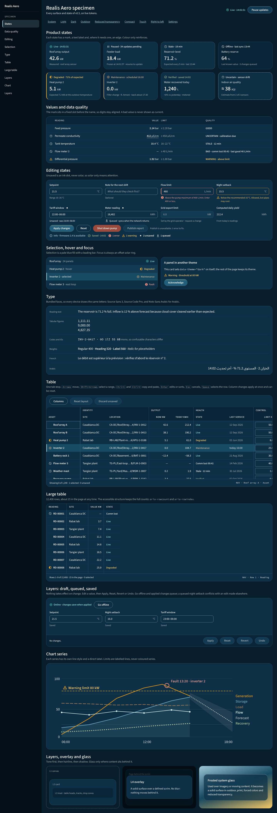
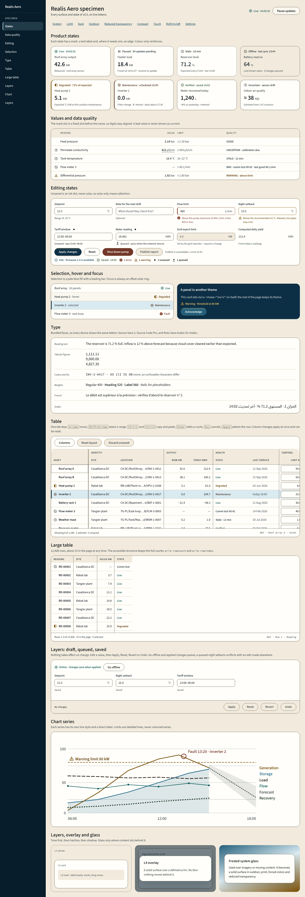
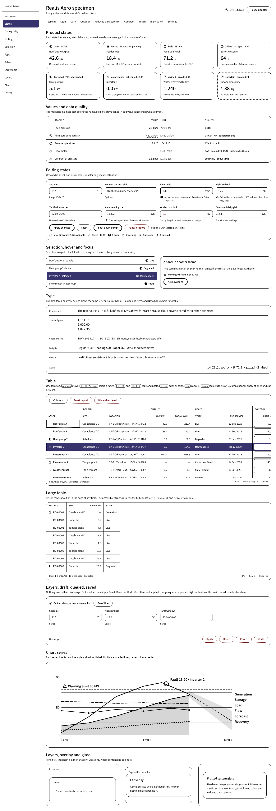
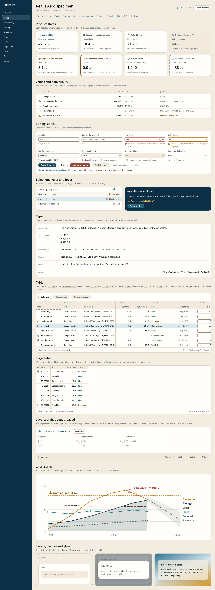
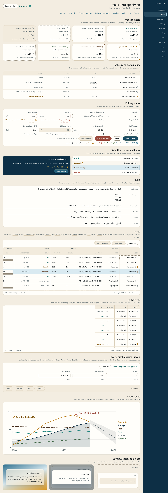
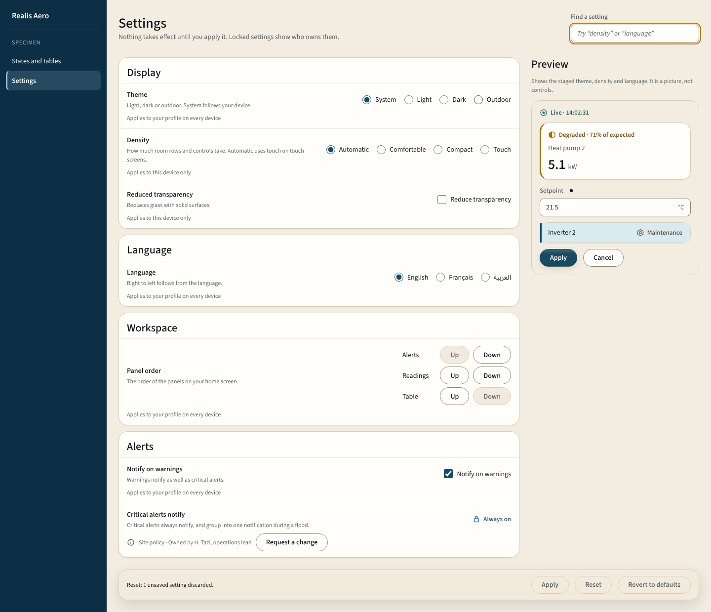
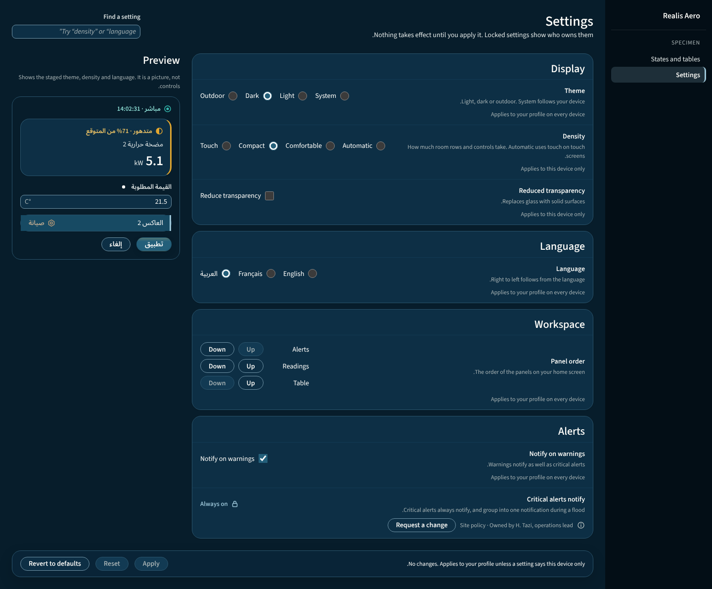

# Realis Aero Design System v0.5

**Version**: 0.5  
**Date**: November 2026 (v0.4: November 2026, v0.3: October 2026, v0.2: May 2026)  
**Vision Holder**: Naji Zouiti  
**Purpose**: Product-ready UI/UX, brand, and implementation specification for a feasible-future aesthetic.

## What Changed in v0.5

v0.5 adds the mechanics that dense and long-running products need. As in v0.4, each addition is in the token file, the specimen and the checks.

- **Density**: comfortable, compact and touch as one token switch. See [Density](#density).
- **Tables and data grids**: anatomy, a keyboard model implemented and tested key by key, and stated limits. See [Tables & Data Grids](#tables--data-grids).
- **Layered state, undo and offline**: baseline, committed, queued and draft layers; Apply, Reset, Revert and Undo; offline as a whole-surface state; conflicts shown, not overwritten. See [Layered State, Undo and Offline](#layered-state-undo-and-offline).
- **Typography as engineering**: bundled open-licensed faces (Source Sans 3, Source Code Pro, Noto Sans Arabic), tabular digits and real weights proven by checks, and a check that every character drawn is covered by a bundled face. See [Font Stack](#font-stack).
- **Right to left**: the layout mirrors through logical properties, and numbers and dates are isolated. See [Internationalization and Right to Left](#internationalization-and-right-to-left).
- **The table model, completed**: range selection, copy and paste with a preview, column visibility, order and width with a keyboard alternative for every pointer action, middle truncation of paths, and a virtualized table of 12,408 rows with a measured budget. See [Tables & Data Grids](#tables--data-grids).
- **A settings screen**: staged until Apply, an inert preview, locked settings with their owner, reordering without a pointer, find and stated scope. See [Settings and Personalization](#settings-and-personalization).
- **Smaller sections**: [Performance](#performance), [Measuring Success](#measuring-success), and zoom in [Accessibility](#accessibility).

Building the checks found defects, corrected here:

- **Numbers and dates broke in right-to-left layouts.** "−12.4" displayed as "12.4−" and "12 Sep 2026" as "Sep 2026 12", because numbers join the bidirectional reordering of their cell. They are now isolated.
- **Charts clipped their labels in right-to-left pages**, because SVG text anchors follow the page direction while the chart's geometry does not. Charts now keep their own direction.
- **The 44px input height** made every desktop form and table taller than the work needs. 44px is now the touch density; comfortable is 36px and compact 28px.
- **Frutiger is a commercial face** that was first in the stack, so a device without it silently drew something else. The stack now leads with a bundled face.
- **The reason an action was unavailable was a message after a click**, not something a screen reader could find first. Every unavailable action now carries its reason as its description, and still announces it when activated.
- **A virtualized table cannot be printed.** In print, the large table's spacer rows made the page about 500,000px tall, thousands of blank pages. The large table is now left out of print, and the page says why.
- **A plain click on a column edge rebuilt the header**, destroying the element before a double click could land on it. A pointer action that changes nothing must not re-render the control under the pointer.

## What Changed in v0.4

v0.4 turns four promises of earlier versions into specifications. Each one is backed by a token file, a working specimen and automated checks that live beside this document.

- **State system**: every product and editing state now has a mark, a text label and, where needed, an edge, with collision rules for the states that share a colour family. See [State System](#state-system).
- **Live values and data quality**: how freshness, pausing and good, uncertain, stale and bad readings are shown on the value itself. See [Live Values and Data Quality](#live-values-and-data-quality).
- **Tokens in three tiers**: primitives, semantic and component tokens in [`tokens/realis-aero.tokens.css`](tokens/realis-aero.tokens.css), which is now the source of truth. See [Token Architecture](#token-architecture).
- **Themes and modes**: a measured dark ladder, an outdoor theme held to AAA, forced colors, print, reduced transparency, and themes that can be set on any element. See [Themes and Modes](#themes-and-modes).
- **Verification**: three scripts measure the tokens and the rendered specimen. See [Verification](#verification).

Measuring found defects in v0.3, corrected here:

- **Focus ring on a selected item** measured 2.94:1 (solar-700 on aero-blue-100). Focus now re-points to a darker solar on selected surfaces (3.47:1), as muted text already did.
- **Chart colours** failed twice. On a card, the generation and live-flow colours measured 2.12:1 and 2.29:1. Under simulated deuteranopia, ecological gain and material collapsed into each other (OKLab distance 0.022 against a 0.07 target). Charts now use dedicated series tokens per theme.
- **Unsaved state used solar**, the family that also means focus and warning. Unsaved is now an ink dot.
- **Disabled contradicted itself** (neutral fill in one section, reduced opacity in another). Neutral fill is the rule; opacity is for imagery only.
- **Motion durations** were specified but missing from the CSS. They are tokens now, and drop to 0ms under reduced motion.

## What Changed in v0.3

v0.3 keeps every v0.2 palette family and principle. It adds the missing rule for **how surfaces stack**, measured on the first desktop product built with the system:

- **Tonal ladder**: five named layers (rail, canvas, card, inset, overlay) with measured separation targets. In v0.2 most adjacent layers sat at 1.03–1.08:1 and merged into one cream field.
- **Dark aerospace rail** for desktop navigation, as the Navigation and Color sections already intended ("dark navigation", "anchor trust in aerospace blue").
- **Readable metadata**: muted text darkened to meet AA on every light surface (v0.2 graphite-500 measured 3.6–4.3:1).
- **Identifiable controls**: a 3:1 control edge for inputs and checkboxes (v0.2 borders measured 1.39:1).
- **Honest overlays**: solid surfaces over a defined scrim; glass only where content moves beneath it.
- **Danger that can be read and acted on**: coral-700 for danger text and destructive buttons.
- **Domain semantics**: how the palette families map onto a product outside energy and ecology.
- **Automated contrast check**: every pair below is meant to be asserted in code against the live tokens.

### v0.3.1: the Ruled Sheet

v0.3.1 adds one pattern, found while building a daily work log: the **Ruled Sheet**, a surface for writing and reading long text that borrows the *structure* of a working notebook (margin, ruled lines, an order of parts) without its texture. Form boxes ask for "a few words"; a ruled page invites the writing the task really needs. See [Ruled Sheet (Writing & Reading)](#ruled-sheet-writing--reading) and [Writing Workspace](#writing-workspace).

## Executive Definition

Realis Aero is a design philosophy for a future that can actually be built. It evolves the calm optimism, clarity, translucency, and nature-technology harmony associated with early digital futurism, but rejects fantasy perfection. Its beauty comes from visible engineering, measurable systems, repairable materials, environmental realism, and human effort.

Realis Aero does not say “the future will magically save us.” It says: **the future becomes beautiful when it is feasible, maintained, measured, and shared.**

## Manifesto & First Principles

### 1. Feasibility Is Beauty

Every visual decision should imply a working system. A beautiful Realis Aero interface shows how power flows, how air moves, how water is conserved, how structures are maintained, how progress is measured, and where trade-offs exist.

- **Do**: Show metrics, tolerances, states, thresholds, structural layers, real progress, and system dependencies.
- **Avoid**: Decorative futurism, meaningless glow, generic “eco” motifs, and impossible utopian environments.

### 2. Honest Translucency

Glass is not decoration. Glass reveals. Translucent surfaces should expose useful depth: data streams, environmental context, component layering, status signals, and internal logic.

- **Do**: Use glass to reveal hierarchy, state, and context.
- **Avoid**: Frosted panels that hide information, ornamental bubbles, fake refraction, or excessive blur.

### 3. Earned Optimism

The tone is optimistic, but never naive. Nature and technology coexist as an engineered symbiosis. The atmosphere is calm because the systems are monitored, repairable, and intentionally designed.

- **Do**: Make the interface feel hopeful through clarity, progress, and control.
- **Avoid**: Heavenly glow, magical automation, “everything is solved” messaging, or effortless perfection.

### 4. Repairable Beauty

The system should feel modular, maintainable, and touched by real use. Imperfection is not damage; it is evidence of care, age, and physical presence.

- **Do**: Use modular panels, visible joins, subtle scratches, fingerprints, wear, replaceable parts, and clear degraded states.
- **Avoid**: Sterile sci-fi surfaces, sealed monoliths, or luxury gloss that cannot be touched.

### 5. Measured Nature-Tech Symbiosis

Nature is not a wallpaper. It is an active system: shade, air, water, biodiversity, growth, solar capture, carbon, and temperature regulation.

- **Do**: Represent natural systems through data, seasonal change, physical constraints, and visible interdependence.
- **Avoid**: Random leaves, decorative vines, or greenwashing without measurable meaning.

### 6. Anti-Escapism Rule

No element may imply that the future is effortless, consequence-free, or disconnected from reality. Every optimistic cue must be backed by an engineering cue.

- **Core test**: If the interface looks beautiful after removing all metrics, states, constraints, and system signals, it may be drifting into escapism.

## Differentiation From Frutiger Aero

Realis Aero is related to Frutiger Aero only through its humanist clarity, environmental softness, and sense of approachable optimism. It is not a nostalgic revival.

| Dimension | Frutiger Aero Tendency | Realis Aero Direction |
|---|---|---|
| **Glass** | Glossy, decorative, magical | Functional, layered, revealing |
| **Nature** | Symbolic freshness | Measured ecological system |
| **Technology** | Seamless consumer optimism | Maintainable engineered infrastructure |
| **Motion** | Bouncy, playful, fluid | Physical, damped, purposeful |
| **Light** | Lens flare and sparkle | Directional daylight, believable reflection |
| **Perfection** | Smooth fantasy surface | Slightly lived-in, repairable, monitored |
| **Future** | Dreamlike promise | Feasible progress |

## Visual Language

### Design Personality

- **Engineered calm**: Interfaces feel composed, precise, and operational rather than luxurious or theatrical.
- **Warm environmental realism**: The palette carries sunlight, mineral surfaces, vegetation, water, and atmospheric depth.
- **Breathable precision**: Layouts are spacious, but not empty. Every element has a job.
- **Visible system intelligence**: Live data, health states, and status indicators are part of the aesthetic.
- **Human-scale futurism**: Controls feel touchable, readable, and serviceable.

### Art Direction Rules

- **Lighting**: Use one believable directional light source, typically diffused daylight or low solar warmth. Shadows must agree with the light source.
- **Depth**: Depth is layered through material, blur, occlusion, shadows, and data overlays. Avoid arbitrary stacking.
- **Atmosphere**: Use subtle haze, temperature shifts, and horizon gradients only when they support environmental realism.
- **Imperfection**: Micro-scratches, smudges, dust, condensation, and worn edges must be subtle and context-aware.
- **Composition**: Large calm surfaces should be balanced by precise live metrics, engineering labels, and modular seams.
- **Imagery**: Prefer real or plausible landscapes, infrastructure, workshops, transit systems, renewable energy fields, weather stations, repair benches, and inhabited environments.

## Product Experience Principles

### The Interface Should Answer

- **What is happening now?**
- **Why is it happening?**
- **What is the system confidence?**
- **What is improving or degrading?**
- **What can the user do next?**
- **What is automated, manual, offline, delayed, or uncertain?**

### Required Product States

Every major product surface should define:

- **Live state**: Data is current and updating.
- **Stale state**: Data is delayed but still usable.
- **Offline state**: System cannot sync; show last-known values.
- **Degraded state**: A subsystem is working below expected range.
- **Maintenance state**: Human intervention is needed or scheduled.
- **Success state**: A measurable improvement occurred.
- **Uncertainty state**: Confidence is low; communicate why.

How each state is drawn is specified in [State System](#state-system).

## Design Tokens

### Token Architecture

Tokens live in [`tokens/realis-aero.tokens.css`](tokens/realis-aero.tokens.css) in three tiers. The tables in this document describe them; the file is the source of truth, and the checks read the file.

| Tier | Naming | Example | Rule |
|---|---|---|---|
| **Primitive** | `--<family>-<step>` | `--aero-blue-800`, `--solar-700` | Raw ramps. Never used by components. |
| **Semantic** | `--color-*`, `--state-*`, `--chart-*`, `--glass-*` | `--color-surface-inset`, `--state-warning-text` | Meaning. Themes re-point these and nothing else. |
| **Component** | `--c-*` | `--c-button-primary-bg`, `--c-row-selected-edge` | Named slots, mapped to semantic tokens. |

- **Components use semantic and component tokens only.** A component that names a primitive cannot follow a theme.
- **A product may adjust primitives** within the measured targets. It does not repurpose a semantic token or add a family.
- **Derived tokens are declared on every themed element.** A token that points at a semantic token (a shadow that uses the theme's shadow tint, every `--c-*` token) is computed where it is declared. Declared on `:root` alone, it would keep the root theme's value inside a panel that sets another theme. The token file declares them on `:root, [data-theme]`, and the render check proves it on a dark panel inside a light page.
- **State tokens come in three roles**: `-mark` for icons and edges (3:1), `-text` for labels (4.5:1), `-tint` for a fill behind text.

### Typography

Realis Aero typography should be humanist, readable, slightly warm, and technically precise. It must not become decorative.

#### Font Stack

```css
--font-sans: "Source Sans 3", "Noto Sans Arabic", "Segoe UI", "Inter", system-ui, sans-serif;
--font-mono: "Source Code Pro", "Noto Sans Arabic", ui-monospace, "JetBrains Mono", monospace;
```

The faces are bundled in [`fonts/`](fonts/), with a licence beside each, and declared in [`fonts/realis-aero.fonts.css`](fonts/realis-aero.fonts.css). All are under the SIL Open Font License 1.1, free for commercial use, embedding and modification.

| Face | For | Why |
|---|---|---|
| **Source Sans 3** (upright and italic, variable 200–900) | Everything that is not code | A humanist sans with the warmth Realis Aero asks for. Its variable weight renders the specified 520, 550 and 560 as written, and it contains every sign and unit the system uses (`≈ ≤ ≥ − · — → µ °`). Its ten digits share one width (472 units), so figures align with no feature switched on. |
| **Source Code Pro** (variable 200–900) | Codes, IDs, shortcuts, status lines | Digits share one width (600 units) and confusable characters differ (`0O 1lI 5S 8B`), so a transcribed code is read correctly. |
| **Noto Sans Arabic** (variable 100–900) | Arabic text | Follows the Latin face in both stacks and is limited by `unicode-range` to Arabic code points, so Latin text never uses it and a page with no Arabic has no reason to fetch it. |

- **Frutiger stays a reference for the feel, not a dependency.** It is commercial and cannot be bundled, so a stack that leads with it renders differently on every device. Source Sans 3 is this document's choice of an open humanist face; a product that licenses Frutiger may put it first, accepting that it then has to bundle it too.
- **Marks are vector shapes, not font glyphs**, so unlike a system that draws its state marks from characters, no symbols font is needed and no device can substitute a different shape (see [State System](#state-system)). Text symbols such as `≈ ≤ − ·` are in the bundled Latin face.
- **No system fallback for drawn characters.** `npm run check:glyphs` reads the WOFF2 character maps and fails if any character the specimen draws is missing from the face that draws it.
- **`font-variant-numeric: tabular-nums` stays on** wherever numbers appear, so a fallback face (a system font on a device that blocked the download) still aligns.

#### Type Scale

| Token | Web Size | Mobile Size | Weight | Line Height | Tracking | Use |
|---|---:|---:|---:|---:|---:|---|
| **display-xl** | 64px | 44px | 500 | 1.05 | -0.02em | Hero statements, manifesto titles |
| **display-lg** | 48px | 36px | 500 | 1.1 | -0.015em | Primary page headers |
| **heading-xl** | 36px | 30px | 520 | 1.15 | -0.01em | Dashboard section titles |
| **heading-lg** | 28px | 24px | 520 | 1.2 | -0.005em | Panel titles |
| **heading-md** | 22px | 20px | 520 | 1.25 | 0 | Card titles |
| **body-lg** | 18px | 17px | 400 | 1.55 | 0 | Primary reading text |
| **body-md** | 16px | 16px | 400 | 1.55 | 0 | Standard UI text |
| **body-sm** | 14px | 14px | 400 | 1.45 | 0.005em | Secondary UI text |
| **metric-lg** | 40px | 32px | 550 | 1.0 | -0.015em | Primary live metrics |
| **metric-md** | 28px | 24px | 550 | 1.05 | -0.01em | Card metrics |
| **label-md** | 13px | 13px | 560 | 1.2 | 0.06em | Labels, tabs, system tags |
| **caption** | 12px | 12px | 400 | 1.35 | 0.02em | Timestamps, units, metadata |

#### Typography Rules

- **Metrics**: Always pair numeric values with units, timestamps, and status context.
- **Labels**: Use sentence case for human clarity; reserve uppercase for compact system tags only.
- **Hierarchy**: Use weight and spacing before using color.
- **Line length**: Keep prose between 58 and 76 characters per line.
- **Numbers**: Use tabular numerals for dashboards, charts, tables and meters. The render check proves the bundled digits share one width.
- **Weights are real**: 400, 520, 550, 560 and 600 each render differently because the faces are variable. A weight that renders the same as its neighbour is a defect.
- **Codes and IDs** use the mono face, so confusable characters differ.
- **Right to left**: numbers and dates are isolated so they keep their reading order inside Arabic text (see [Internationalization and Right to Left](#internationalization-and-right-to-left)).

### Color System

The Realis Aero palette is a balanced feasible-future system. It should not read as “green tech.” It should feel like clean air, aerospace depth, repairable infrastructure, calibrated white surfaces, measured sunlight, live sensors, and grounded material reality.

White is the equilibrium layer: it creates breathing room, calibration, glass reflection, and human clarity. Dark aerospace blue is the trust layer: it anchors dashboards, navigation, night systems, and atmospheric depth. Professional umber is the material layer: it brings infrastructure, repairability, soil, wood, ceramic, and hardware warmth. Refined solar yellow is the energy layer: it signals sunlight, focus, progress, and instrumentation. Teal/cyan is the live-system layer only. Green is reserved for verified ecological gain, not general branding.

#### Primitive Palette

| Token | Hex | Role |
|---|---|---|
| **equilibrium-white-000** | `#FFFEFA` | Pure equilibrium white, readable glass reflection |
| **equilibrium-white-050** | `#FAF7F0` | Breathable highlight; hover on white surfaces |
| **equilibrium-white-075** | `#F3EDE1` | Workspace canvas (v0.3) |
| **equilibrium-white-100** | `#F2EBDD` | Warm calibrated surface |
| **equilibrium-white-200** | `#E3D9C7` | Soft mineral border and disabled surface |
| **equilibrium-white-300** | `#D9CDB6` | Card hairline (v0.3) |
| **mineral-500** | `#8F8574` | Control edge: inputs, checkboxes, drop zones (v0.3) |
| **aero-blue-950** | `#071D2B` | Deep aerospace night, primary dark anchor |
| **aero-blue-900** | `#0D2F45` | Cockpit surface, dark navigation |
| **aero-blue-800** | `#174A63` | Primary engineering blue |
| **aero-blue-700** | `#235F7A` | Hover/active blue |
| **aero-blue-600** | `#2D6F8E` | Info, atmospheric data, secondary action |
| **aero-blue-300** | `#9CC6D8` | Pale atmospheric highlight |
| **aero-blue-100** | `#D9EAF1` | Light blue surface tint |
| **umber-900** | `#3A2A1E` | Deep professional brown, material text |
| **umber-800** | `#4C3524` | Hardware, rail, handle, dark material |
| **umber-700** | `#65462F` | Infrastructure and maintenance anchor |
| **umber-600** | `#7D5A3B` | Grounded secondary accent |
| **umber-500** | `#8B6848` | Load, consumption, tactile material |
| **umber-300** | `#B79A78` | Warm material highlight |
| **umber-100** | `#EFE3D2` | Soft material surface |
| **solar-900** | `#5F3A02` | Deep solar text and high-contrast energy |
| **solar-800** | `#7A4F05` | Serious instrumentation yellow-brown |
| **solar-700** | `#B87912` | Warning, threshold, strong energy |
| **solar-600** | `#D79520` | Active energy and progress |
| **solar-500** | `#E3A72F` | Refined Realis solar |
| **solar-300** | `#F3C766` | Warm reflection and focus glow |
| **solar-100** | `#FFF0BF` | Pale sunlight surface |
| **teal-system-800** | `#0D5C5A` | Deep live-system teal |
| **teal-system-700** | `#1B817B` | Sensor and flow accent |
| **teal-system-500** | `#35BDB2` | Live data stream |
| **teal-system-300** | `#8FE1D8` | Soft live-data glow |
| **teal-system-100** | `#D9F4F0` | Pale system-flow surface |
| **bio-green-800** | `#315A3C` | Verified ecological depth |
| **bio-green-600** | `#5E8156` | Ecological success |
| **bio-green-400** | `#9CB58D` | Soft restoration highlight |
| **bio-green-100** | `#E4ECD8` | Pale ecological proof surface |
| **signal-coral-800** | `#85402F` | Destructive fill, hover (v0.3) |
| **signal-coral-700** | `#9A4A3D` | Danger text and destructive fill (v0.3) |
| **signal-coral-600** | `#B85F52` | Critical fault, urgent maintenance; icons, edges and tints |
| **signal-coral-300** | `#E08A7B` | Soft critical highlight |

#### Primitives Added in v0.4

Every one of these exists because a measured pair needed it.

| Token | Hex | Role |
|---|---|---|
| **aero-blue-975** | `#030E16` | Dark rail |
| **aero-blue-925** | `#092437` | Dark inset |
| **aero-blue-875** | `#123A53` | Dark hover, row divider, disabled fill |
| **aero-blue-750** | `#2A546C` | Dark card edge |
| **aero-blue-450** | `#6F93A6` | Dark control edge |
| **solar-750** | `#A86E10` | Warning mark; focus ring on selected surfaces |
| **umber-200** | `#C6AF93` | Maintenance text on dark |
| **bio-green-300** | `#A2B994` | Success text on dark |
| **bio-green-900** | `#2C5035` | Success text, outdoor |
| **teal-system-900** | `#0B514F` | Live text, outdoor |
| **signal-coral-100** | `#F6E3DD` | Error tint |
| **signal-coral-200** | `#E6A194` | Danger text on dark |
| **signal-coral-900** | `#723728` | Danger text and destructive fill, outdoor |
| **signal-coral-950** | `#5A2A1E` | Destructive hover, outdoor |
| **mineral-600** / **mineral-700** | `#6D6454` / `#5F574A` | Outdoor card edge / control edge |
| **graphite-700** | `#3B474C` | Outdoor muted text |
| **graphite-975** | `#0A1014` | Outdoor primary text |

#### Neutral Palette

| Token | Hex | Role |
|---|---|---|
| **white-equilibrium** | `#FFFEFA` | Highest-clarity surface; not sterile pure white |
| **white-calibration** | `#FAF7F0` | Default calm canvas |
| **mineral-surface** | `#F2EBDD` | Raised surface and readable glass backing |
| **mineral-border** | `#E3D9C7` | Warm border, divider, disabled fill |
| **blue-black** | `#071D2B` | Dark mode background and depth anchor |
| **graphite-950** | `#11181C` | Highest contrast text |
| **graphite-900** | `#172126` | Dark text and dark neutral surface |
| **graphite-800** | `#263238` | Secondary dark surface |
| **graphite-600** | `#58666B` | Muted text and forecast line |
| **graphite-550** | `#5F6C70` | Muted metadata, AA on every light surface (v0.3) |
| **graphite-500** | `#6F7C80` | Large decorative labels only (fails AA at body size) |
| **graphite-400** | `#A9B4B5` | Metadata, disabled text, cool divider |
| **graphite-100** | `#E0E6E5` | Pale cool separator |

#### Semantic Color Roles

| Role | Light Mode | Dark Mode | Notes |
|---|---|---|---|
| **background** | `#F3EDE1` | `#071D2B` | L1 canvas / aerospace night (v0.3: was `#FAF7F0`) |
| **surface** | `#FFFEFA` | `#0D2F45` | L2 cards and overlays |
| **surface-inset** | `#F2EBDD` | `#092437` | L3 regions inside cards: table heads, section rows, tracks |
| **surface-hover** | `#FAF7F0` | `#123A53` | Row and item hover on white |
| **surface-selected** | `#D9EAF1` | `#174A63` | Selected item: rail entry, focused grid row, active filter |
| **text-muted-on-selected** | `#58666B` | `#E0E6E5` | Muted text inside a selected item (4.82:1; graphite-550 gives 4.40) |
| **surface-raised** | `#F2EBDD` | `#174A63` | Raised cards, panels, and controls |
| **surface-material** | `#EFE3D2` | `#3A2A1E` | Infrastructure and maintenance surfaces |
| **text-primary** | `#11181C` | `#FFFEFA` | Body and headings |
| **text-secondary** | `#58666B` | `#E0E6E5` | Supporting text |
| **text-muted** | `#5F6C70` | `#A9B4B5` | Metadata, labels, hints, placeholders (v0.3) |
| **danger-text** | `#9A4A3D` | `#E6A194` | Error text and destructive buttons (v0.3) |
| **border-subtle** | `#F2EBDD` | `#123A53` | Row dividers inside cards |
| **border-card** | `#D9CDB6` | `#2A546C` | Card hairlines, structural dividers |
| **border-control** | `#8F8574` | `#6F93A6` | Inputs, checkboxes, drop zones (≥ 3:1) |
| **scrim** | `rgba(7, 29, 43, 0.40)` | `rgba(0, 0, 0, 0.55)` | Behind dialogs and side panels |
| **disabled-fill / disabled-text** | `#F2EBDD` / `#58666B` | `#123A53` / `#A9B4B5` | Disabled primary actions |
| **rail** | `#0D2F45` | `#030E16` | L0 desktop navigation; the darkest layer in dark |
| **action-primary** | `#174A63` | `#235F7A` | Primary buttons, active nav, engineering trust |
| **action-primary-hover** | `#0D2F45` | `#2D6F8E` | Hover and selected emphasis |
| **focus-ring** | `#B87912` | `#F3C766` | High-visibility solar focus |
| **focus-ring-on-selected** | `#A86E10` | `#F3C766` | Focus on a selected item (v0.4: solar-700 measured 2.94:1 there) |
| **selected-edge** | `#174A63` | `#9CC6D8` | The 3px leading bar of a selected item (v0.4) |
| **text-on-action** | `#FFFEFA` | `#FFFEFA` | Label on a filled action (v0.4) |
| **action-danger / hover** | `#9A4A3D` / `#85402F` | `#9A4A3D` / `#85402F` | Destructive fill (v0.4) |
| **energy** | `#D79520` | `#F3C766` | Generation, progress, sunlight, instrument highlight |
| **material** | `#65462F` | `#B79A78` | Infrastructure, repair, tactile systems |
| **success** | `#5E8156` | `#9CB58D` | Verified ecological gain only |
| **warning** | `#B87912` | `#F3C766` | Threshold or upcoming maintenance |
| **danger** | `#B85F52` | `#E08A7B` | Urgent fault |
| **info** | `#2D6F8E` | `#9CC6D8` | Atmospheric/system information |
| **live-data** | `#35BDB2` | `#8FE1D8` | Real-time streams only |

The family accents from **energy** to **live-data** are for icons, edges and fills, never text: several of them sit below 4.5:1 on a card. Text and marks that carry a state use the [state tokens](#state-tokens). Outdoor values for every role are in [Themes and Modes](#themes-and-modes) and the token file.

#### Data Visualization Colors

Charts use their own series tokens. The family accents cannot be used directly: on a card, solar-500 measures 2.12:1 and teal-500 2.29:1, and bio-green-600 and umber-500 are 0.022 apart in OKLab under simulated deuteranopia.

| Meaning | Token | Light | Dark | Outdoor | Secondary encoding (required) |
|---|---|---|---|---|---|
| **Generation / output** | `chart-generation` | `#B87912` | `#D79520` | `#734A04` | Solid 2px line |
| **Storage / reserve** | `chart-storage` | `#0D2F45` | `#659BB3` | `#2D6F8E` | Solid line over a 16% filled area |
| **Live flow / sensor stream** | `chart-flow` | `#1B817B` | `#D9F4F0` | `#0D5C5A` | Thin 1.5px line with a dot at each reading |
| **Ecological gain** | `chart-eco` | `#3C6443` | `#A2B994` | `#223F2A` | Round-capped dotted line |
| **Material / load / infrastructure** | `chart-material` | `#4C3524` | `#967554` | `#291D15` | Long-dashed line |
| **Forecast / uncertainty** | `chart-forecast` | `#58666B` | `#A9B4B5` | `#3B474C` | Dotted line and confidence band |
| **Warning limit** | `chart-threshold` | warning mark | warning mark | warning mark | Dashed horizontal line with a triangle and a text label |
| **Fault / critical** | `chart-fault` | error mark | error mark | error mark | Ring marker with a text label |
| **Selected point or entity** | `chart-selected` | selected edge | selected edge | selected edge | Outlined marker; the same edge as a selected row |

**Rules**

- **Measured**: every series reaches 3:1 on a card and on an inset (4.5:1 in outdoor), and the five family series stay at least 0.07 apart in OKLab under simulated protanopia, deuteranopia and tritanopia, in every theme.
- **Line style is not optional.** Colour separates the series for most readers; the line style and a direct label at the end of each series separate them for everyone, in grayscale and in forced colors.
- **Limits and faults are marks, not series.** A warning limit is a labelled line; a fault is a labelled ring. Status colours never colour a data series.
- **Energy peak** is a labelled marker on the generation series, not a colour of its own.
- **More than five series** means small multiples or direct labels, not more hues.

#### Color Rules

- **Never rely on color alone**: Pair color with icon, label, pattern, stroke style, or shape.
- **Use white as equilibrium**: White is for calibration, clarity, glass reflection, and breathing space; avoid sterile blankness.
- **Anchor trust in aerospace blue**: Primary navigation, major actions, and dark surfaces should lean blue before teal.
- **Use umber for material truth**: Brown should signal infrastructure, repairability, load, earth, wood, ceramic, and hardware.
- **Use solar yellow sparingly**: It is for measured energy, sunlight, progress, focus, and instrumentation—not decoration.
- **Do not use pale solar as body text**: Use `solar-800` or `solar-900` for text on light surfaces; reserve `solar-300` and `solar-100` for glow, fills, and reflection.
- **Reserve teal/cyan for live systems**: Data glow should be controlled and tied to real updates, sensors, water, air, or flow.
- **Reserve green for ecological proof**: Green means verified restoration, growth, or ecological success, not generic positivity.
- **Treat coral as operational**: Coral means a real issue, not decorative contrast.

#### Recommended Palette Balance

| Family | Target Presence | Purpose |
|---|---:|---|
| **Equilibrium white / mineral surfaces** | 35–45% | Calm, readability, calibration, breathable space |
| **Aerospace blue / graphite depth** | 25–35% | Trust, engineering, navigation, dashboard structure |
| **Professional umber** | 8–14% | Materiality, grounding, repairability, infrastructure |
| **Refined solar** | 5–8% | Energy, focus, progress, sunlight, active instrumentation |
| **Teal/cyan live systems** | 3–6% | Sensors, flow, real-time updates, data streams |
| **Bio green** | 2–4% | Verified ecological success and restoration only |
| **Signal coral** | <2% | Critical operational states |

### Surface Layering (Tonal Ladder) — v0.3

Depth is communicated by tone first, then hairline, then shadow. Each layer has one job and a measured distance from its neighbours.

| Layer | Role | Token | Measured separation |
|---|---|---|---|
| **L0 Rail** | Persistent navigation, the stable frame | `rail` (aero-blue-900, solid) | 11.9:1 vs canvas; labels 13.8:1 |
| **L1 Canvas** | Workspace behind all content | `background` `#F3EDE1` | — |
| **L2 Card** | Panels, steps, toasts, dialogs | `surface` + `border-card` + elevation-1 | 1.16:1 vs canvas |
| **L3 Inset** | Regions inside a card: table heads, section rows, preview tracks, drop zones | `surface-inset` | 1.18:1 vs card |
| **L4 Overlay** | Side panels and dialogs | solid `surface` over `scrim`, elevation-4 | 2.8:1 vs the dimmed page |

**Targets** (asserted by the automated check): layers ≥ 1.12:1 from their neighbour; control edges and focus rings ≥ 3:1; all text ≥ 4.5:1 on every surface it can sit on.

**Rules**

- **Components placed on the canvas use the white surface**, not `surface-raised`: a raised track on the canvas measures 1.02:1 and disappears (segmented controls, chips, selects).
- **Inside an overlay, repeat the ladder**: a side panel is a workspace (canvas + white step cards) with a solid white header.
- **Glass only over moving content**: toasts and sticky elements over scrolling lists. A sidebar or header over a flat canvas is solid; blur that reveals nothing is decoration (see Honest Translucency) and costs rendering time.
- **One filled action per surface.** Primary is filled aerospace blue; a dialog's destructive answer is filled coral-700; everything else is outlined or ghost.
- **Disabled is neutral**: mineral fill and graphite text, never a faded primary that still looks clickable.
- **Selected items re-point muted text**: on `surface-selected` the muted token steps up to `text-muted-on-selected`, so metadata inside a selected row or card stays AA without per-element overrides.
- **Placeholders use the muted token**, never the browser default grey (3.9:1 on inset surfaces).
- **Table rows keep one height**: a list inside a cell (tags, groups, assignees) stays on one line, shows the first items and a "+N" toggle, and opens a detail row in the inset band below, grouped by meaning (e.g. members by team). The toggle keeps the same label open or closed and the detail never widens the columns, so nothing re-flows. A remainder of one is shown rather than "+1"; items matching the current search come first and are outlined.
- **Dense grids may identify cells by structure**: editable cells in a data-entry grid use an inset fill with a card edge, the control edge on hover and the solar ring on focus, so 35 rows do not turn into a wall of dark borders.

**Dark rail details**: labels graphite-100; strong labels white; hover white 6%; active `rgba(156, 198, 216, 0.18)` with a 3px aero-blue-300 bar; focus ring solar-300; role pill aero-blue-300 on the active tint; dividers white 10%.

### Domain Semantics: Mapping the Palette to a Product

The family rules above were written for energy and ecological systems. A product in another domain (records, scheduling, education, operations) keeps each family's *intent* and maps its own concepts onto it:

| Family | Intent | Meaning in a general product |
|---|---|---|
| **Aerospace blue** | Structure and trust | Navigation, primary action, selection; the product's everyday record type |
| **Umber** | Material, weight, record | The formal or archival record type, when the product distinguishes one from everyday work |
| **Solar** | Energy and thresholds | Focus, attention, in-progress, warnings and thresholds. Not unsaved work (v0.4): that is an ink dot, see [State System](#state-system) |
| **Bio green** | Verified proof | Confirmed by the system of record: saved, completed, published |
| **Signal coral** | Critical states | Faults, invalid input, destructive actions |
| **Teal** | Live systems | Reserved for a live sync indicator; never decoration |

**Rules**

- **Map once, in writing**: each product records its mapping next to its tokens. A family never carries two unrelated meanings in the same product.
- **Status follows the same table**: *planned* is neutral (nothing to signal yet), *partial* or *needs attention* is solar, *done and recorded* is bio green.
- **Coverage views**: paint what exists in aerospace blue, leave gaps on the inset tone, and use one solar marker per row that has nothing recorded. Colour is never the only signal; counts and labels stay.
- **Do not borrow a family for variety**: if a product has more categories than families, distinguish them by label, icon or position rather than by new colours.

Long-form records are written and read on the [Ruled Sheet](#ruled-sheet-writing--reading); its highlighted part is the one the record's audience reads first (for example, the action expected before the next session).

### Spacing

Use an 8px base grid with 4px micro-adjustments for dense instrumentation.

| Token | Value | Use |
|---|---:|---|
| **space-1** | 4px | Icon-text gaps, dense labels |
| **space-2** | 8px | Compact component spacing |
| **space-3** | 12px | Inline form gaps |
| **space-4** | 16px | Card internal spacing |
| **space-5** | 20px | Compact panel padding |
| **space-6** | 24px | Standard section spacing |
| **space-8** | 32px | Major panel spacing |
| **space-10** | 40px | Hero and dashboard bands |
| **space-12** | 48px | Page rhythm |
| **space-16** | 64px | Large breathable divisions |
| **space-24** | 96px | Landing page sections |

### Density

One switch changes spacing and size for the whole interface. Density never changes type size, content or capability: the same rows, limits and states appear in every density.

| Token | Comfortable | Compact | Touch |
|---|---:|---:|---:|
| `density-control-h` | 36px | 28px | 44px |
| `density-row-h` | 40px | 32px | 48px |
| `density-gap-intra` | 8px | 4px | 8px |
| `density-gap-inter` | 16px | 12px | 16px |
| `density-pad-x` | 12px | 8px | 16px |
| **For** | Default for desktop work | Tables, monitoring, power use | Phones, tablets, handhelds |

- **Set with `data-density` on any element**, like a theme, so one region can be compact inside a comfortable page. With no attribute, a coarse pointer gets touch and everything else gets comfortable.
- **Compact never falls below 24px** (WCAG 2.5.8). In a table the target is the whole cell, not the inner input box: in compact the editable cell's visible box is inset but stays at least 24px high.
- **44px is the touch density**, not a universal floor. Desktop forms and tables are no longer 44px tall just because a phone needs it; a product that ships to touch devices uses touch there.
- **Rows keep one height** within a density, whatever they contain.
- **Density is a user choice**, offered in [Settings and Personalization](#settings-and-personalization), not a layout the product guesses from the screen width alone.

### Radius

| Token | Value | Use |
|---|---:|---|
| **radius-xs** | 4px | Data chips, tags |
| **radius-sm** | 8px | Inputs, compact buttons |
| **radius-md** | 12px | Standard controls |
| **radius-lg** | 18px | Cards and panels |
| **radius-xl** | 24px | Hero glass panels |
| **radius-pill** | 999px | Capsules and segmented controls |

### Elevation & Shadow

Shadows should feel physical, soft, and directional. They should not create floating fantasy objects.

| Token | Value | Use |
|---|---|---|
| **elevation-0** | none | Flat surfaces |
| **elevation-1** | `0 1px 2px rgba(7, 29, 43, 0.08)` | Inputs, small chips |
| **elevation-2** | `0 4px 12px rgba(7, 29, 43, 0.10)` | Buttons, compact cards |
| **elevation-3** | `0 10px 28px rgba(7, 29, 43, 0.14)` | Panels, modals |
| **elevation-4** | `0 20px 54px rgba(7, 29, 43, 0.18)` | Hero overlays only |
| **inner-highlight** | `inset 0 1px 0 rgba(255, 254, 250, 0.42)` | Glass and bevels |
| **inner-depth** | `inset 0 -1px 0 rgba(7, 29, 43, 0.10)` | Pressable controls |

### Blur, Opacity & Stroke

| Token | Value | Use |
|---|---:|---|
| **blur-sm** | 8px | Dense UI glass |
| **blur-md** | 14px | Standard glass panels |
| **blur-lg** | 24px | Large background glass |
| **opacity-glass-clear** | 0.72 | Clear operational glass |
| **opacity-glass-frosted** | 0.82 | Frosted system glass |
| **opacity-disabled** | 0.42 | Disabled imagery and illustrations only; controls use `disabled-fill` and `disabled-text` (v0.4) |
| **stroke-hairline** | 0.5px | High-density visualizations |
| **stroke-sm** | 1px | Standard borders |
| **stroke-md** | 1.5px | Active controls |
| **stroke-lg** | 2px | Focus, critical states |

### Layout & Grid

#### Desktop

- **Canvas**: 1440px reference width.
- **Content max width**: 1200px for documentation and landing pages.
- **Dashboard grid**: 12 columns, 24px gutters, 24px outer margin minimum.
- **Panel rhythm**: Primary panels span 6 to 8 columns; secondary panels span 3 to 4 columns.

#### Tablet

- **Grid**: 8 columns, 20px gutters, 20px margins.
- **Navigation**: Side rail may collapse to icons plus labels on hover/focus.
- **Charts**: Prefer stacked layouts over compressed multi-column dashboards.

#### Mobile

- **Grid**: 4 columns, 16px gutters, 16px margins.
- **Touch target**: Minimum 44px by 44px.
- **Primary actions**: Bottom-aligned or sticky only when they do not cover live alerts.
- **Metrics**: Show fewer metrics with clearer hierarchy; allow drill-down for complexity.

## Material System

### Material Philosophy

Materials should feel like they belong to instruments, vehicles, public infrastructure, renewable systems, and repairable personal devices. Glass, metal, polymer, rubber, ceramic, water, air, and vegetation should be represented with restraint.

### Glass Material Variants

| Material | Background | Blur | Border | Shadow | Use |
|---|---|---:|---|---|---|
| **Clear Operational Glass** | `rgba(255, 254, 250, 0.58)` | 8px | `rgba(255, 254, 250, 0.42)` | elevation-2 | Compact controls, live labels |
| **Frosted System Glass** | `rgba(242, 235, 221, 0.72)` | 14px | `rgba(255, 254, 250, 0.34)` | elevation-3 | Panels over imagery or moving content (a sign-in card over a photographic background); not over a flat canvas (v0.3) |
| **Dense Hardware Glass** | `rgba(7, 29, 43, 0.72)` | 18px | `rgba(156, 198, 216, 0.28)` | elevation-3 | Dark instrument panels |
| **Alert Glass** | `rgba(255, 254, 250, 0.78)` | 12px | semantic warning/danger border | elevation-3 | Alerts, maintenance states |
| **Reduced Transparency Surface** | solid semantic surface | 0px | standard border | elevation-1 | Accessibility fallback |

### Imperfection Rules

Imperfections should signal real use, not visual noise.

- **Micro-scratches**: 1px or thinner, 3% to 8% opacity, aligned with plausible touch or cleaning direction.
- **Fingerprints**: Use only on touch surfaces and only at large sizes or close-up views.
- **Condensation**: Use near weather, cooling, water, greenhouse, or thermal systems; never as generic decoration.
- **Dust or pollen**: Use for outdoor infrastructure, vents, sensor housings, and seasonal surfaces.
- **Wear**: Apply to edges, handles, frequently pressed buttons, and replaceable modules.

### Internal Data Layer

Glass panels may reveal low-intensity system lines beneath the surface.

- **Line opacity**: 10% to 28%.
- **Line width**: 1px to 2px.
- **Glow**: Use `teal-system-500` at low opacity; pulse only on fresh data.
- **Meaning**: Every stream must map to a real category: power, water, air, heat, carbon, network, maintenance, or movement.
- **Animation**: Idle streams should barely move or remain still; live updates may pulse once.

## State System

A state is never a colour alone. Each one has a **mark** (a shape), a **text label**, and where it needs one an **edge** (a real border). Colour reinforces. The test: every state on the specimen can still be told apart in the grayscale and forced-colors renders.

Marks are drawn as vector shapes on a 16px grid with a 1.5px stroke, so they do not depend on the device's fonts. The specimen holds the set in [`specimen/index.html`](specimen/index.html).

### Product States

The seven required product states, plus paused. These describe a system, a subsystem or a whole surface.

| State | Mark | Label pattern | Edge and surface | Family |
|---|---|---|---|---|
| **Live** | Ring with a filled centre | "Live · 14:02:31" | None | Teal |
| **Paused** | Two bars | "Paused · 34 updates pending" | None | Neutral |
| **Stale** | Clock | "Stale · 18 min" (the age is required) | Dashed border in the control tone; value in secondary text | Neutral |
| **Offline** | Circle with a slash | "Offline · last sync 13:44" | Inset fill, no shadow, no glass; value in secondary text | Neutral |
| **Degraded** | Half-filled circle | "Degraded · 71% of expected" | 3px leading edge | Solar |
| **Maintenance** | Hexagonal nut | "Maintenance · scheduled 16:00" (who and when) | 3px leading edge | Umber |
| **Success** | Circle with a check, outlined | "Verified · saved 14:02" | None | Bio green |
| **Uncertain** | Dotted circle with a question mark | "Uncertain · sensor drift" (the reason is required) | 2px dotted border; value prefixed "≈" | Neutral |

- **The label says what the mark cannot**: the age of stale data, the reason for uncertainty, who is doing the maintenance and until when.
- **Maintenance is umber, not solar.** It is planned human work on a repairable system, which is what the umber family means. v0.3's reference component painted it as a warning.
- **Live pulses once.** A fresh reading may pulse its mark once (`motion-live-pulse`, 600ms) and settle. Nothing loops. Under reduced motion the pulse is removed and the label carries the state.

### Live Values and Data Quality

A product state describes a surface; data quality describes one value. Both can be present.

- **Freshness is visible.** A live region shows when it last updated and whether updates are running: "Live · 14:02:31" or "Paused · 34 updates pending".
- **Pausing is allowed and explicit.** The user can freeze a live view to read it. The control is labelled, its pressed state is exposed, and the indicator changes shape (ring to bars) as well as text.
- **A fixed marker slot sits before the name**, one mark wide, on every row. Digits stay aligned whether or not a mark is present.
- **Every value carries a text quality label** where quality matters:

| Quality | Shown as |
|---|---|
| **Good** | The value, plainly. No mark. |
| **Uncertain** | The value with a dotted underline, the uncertain mark and the reason ("calibration due") |
| **Stale** | The value in secondary text, the clock mark and its age ("12 min") |
| **Bad or communication lost** | The value is replaced by "—". The label gives the age of the failure and the last good value ("comm lost 00:42 · last good 46 L/min"). The last good value is never shown as if it were current. |

- **The limit sits beside the value** it constrains ("1.92 bar" next to "≤ 1.80 bar"), so a reading can be judged without opening anything.
- **In charts**, limits are labelled lines and faults are labelled rings (see [Data Visualization Colors](#data-visualization-colors)).

### Editing and Interaction States

| State | Treatment | Family |
|---|---|---|
| **Hover** | `surface-hover` fill | Neutral |
| **Selected** | `surface-selected` fill and a 3px leading bar in `selected-edge`; muted text and the focus ring re-point | Aerospace blue |
| **Focus** | 2px solar ring, offset 2px outside the element (inset inside list rows). Never removed, never a fill. | Solar |
| **Editable** | Surface fill with a 1px control edge (3:1) | Neutral |
| **Read-only / computed** | No edge; takes the surface it sits on | Neutral |
| **Unsaved** | A filled ink dot after the field's label, and "Unsaved · was …" under the field | Ink |
| **Queued (offline)** | The unsaved dot, plus an up-arrow mark and "Queued · syncs when the network returns" | Ink |
| **Error** | Coral control edge with a 3px leading edge; filled circle with an exclamation mark; a message that says how to fix it | Signal coral |
| **Warning** | Solar control edge; outlined triangle; a message. The value is allowed. | Solar |
| **Info** | Outlined circle with an "i" | Aerospace blue |
| **Disabled** | `disabled-fill` and `disabled-text`, card-tone edge. Never reduced opacity. The control stays focusable (`aria-disabled="true"`, not the native attribute) and its reason is tied to it with `aria-describedby`. | Neutral |

### Collision Rules

Realis Aero has more meanings than families, so some states share a colour. These rules keep them apart.

- **Focus, warning and degraded are all solar.** They differ by shape: focus is always an offset ring and nothing else; warning is always a triangle with a border *on* the control; degraded is always a half-filled circle with a leading edge on a card. Solar is never a fill behind text for any of them.
- **Unsaved is ink, not solar.** A screen full of edits must not look like a screen full of warnings.
- **Selected, info and the primary action are all aerospace blue.** Selected is a pale fill with a bar; info is an outlined mark with text; primary is a filled button. Blue text on its own always means a link or info, never selection.
- **Live and success are neighbours in hue** and close under colour-vision deficiency. Live is a ring with a centre and a time; success is a check and a past-tense word.
- **Stale, uncertain and forecast are all neutral.** Stale is dashed and has an age; uncertain is dotted and has a reason; forecast is a dotted line with a band, in charts only.
- **Maintenance is not a fault.** Umber with a nut means planned work; coral with a filled circle means something broke.
- **Error outranks warning.** One mark per message; when a value has both, the error is shown and the warning is counted.
- **Offline wins over glass.** An offline surface is solid and recessed, whatever material it used when live.
- **A disabled primary loses its fill.** A filled button looks actionable, and disabled text on aerospace blue is unreadable.
- **On a selected item, re-point; do not override.** `text-muted` becomes `text-muted-on-selected` and the focus ring becomes `focus-ring-on-selected`, once, on the selected element.
- **Edges are borders, and only where the state is.** A state edge is drawn with `border`, never `box-shadow`, and no transparent edge is reserved on items that do not have the state: forced colors removes shadows and paints transparent borders.

### State Tokens

| State | Mark (≥ 3:1) | Text (≥ 4.5:1) | Tint |
|---|---|---|---|
| **live** | teal-system-700 | teal-system-800 | — |
| **success** | bio-green-600 | bio-green-800 | bio-green-100 |
| **warning** / **degraded** | solar-750 | solar-800 | solar-100 |
| **error** | signal-coral-600 | signal-coral-700 | signal-coral-100 |
| **maintenance** | umber-600 | umber-700 | umber-100 |
| **info** | aero-blue-600 | aero-blue-700 | — |
| **neutral** (paused, stale, offline, uncertain, bad) | graphite-600 | text-secondary | — |
| **dirty** (unsaved, queued) | text-primary | text-primary | — |

Light values are shown; dark and outdoor values are in the token file. Each text token is measured on the canvas, card, hover, inset, raised and selected surfaces and on its own tint, and each mark on the canvas, card, inset and selected surfaces.

## Layered State, Undo and Offline

A value can be in four places at once: the one that was opened, the last saved one, one waiting for the network, and the one being typed. Showing which is the difference between a tool that can be trusted with a setpoint and one that cannot. The specimen's [Layers section](specimen/index.html#layers-section) implements this model in [`specimen/layers.js`](specimen/layers.js).

### The Layers

```
baseline  →  committed  →  queued  →  draft
 opened       saved         applied     being typed
                            offline
```

- **A field shows the top layer that holds a value for it.** Its marks and messages are computed by comparing a layer with the one below, never stored as flags.
- **Draft** differs from the layer below: the ink dot and "Unsaved · was 21.5".
- **Queued** was applied while offline: the dot, the up-arrow mark and "Queued · was 16.0 · syncs when the network returns".
- **Committed** differs from the baseline: "Saved · was 21.5 when opened". A value the user never touched says only "Saved".
- **Typing the layer below back clears the draft**, and with it the mark.

### Apply, Reset, Revert and Undo

| Action | What it does | Unavailable when |
|---|---|---|
| **Apply** | Commits the draft as **one named change** ("Applied 2 changes"). Offline, the label becomes **Apply offline** and the change is queued instead. | There is no draft |
| **Reset** | Discards the draft and returns to what is saved (or queued) | There is no draft |
| **Revert** | Returns saved values to the baseline, the values that were opened. It is itself undoable. | Nothing differs from the baseline, or the surface is offline |
| **Undo** | Reverses the last named change, whole. Resolving a conflict is a named change too. | There is nothing to undo |

- **Nothing takes effect on change.** Editing creates a draft; only Apply writes.
- **The apply bar is persistent**: counts of unsaved and queued changes (shown only when above zero), the four actions, and a status line, so the state of the work is visible without opening anything.
- **An unavailable action explains itself.** All four use `aria-disabled` rather than the native attribute, so they stay focusable. The reason is the control's description ("Nothing to apply: no unsaved changes."), and it is announced in the polite status line when the action is activated.
- **Recent named changes are listed** (the last three), so Undo is never a guess.
- **Every result is announced** in the status line: "Applied 2 changes.", "Reset: 1 unsaved change discarded.", "Reverted to the values that were opened."

### Offline and Sync

Offline is a state of the whole surface, never a surprise.

- **Text and mark both say so**: "Offline · changes queue until the network returns" with the slashed circle, in place of the live mark.
- **The apply bar changes with it**: Apply becomes Apply offline, and Revert is unavailable because it changes saved values the user cannot see are still current.
- **Queued changes are never lost and never silently overwrite.** On reconnect, changes that do not conflict sync; the result is reported as a partial outcome ("Back online: 1 change synced, 1 conflict to resolve.").
- **A conflict is shown, not decided**: "Conflict · Night setback: yours 15.5, theirs 17.0 (L. Haddad, 14:03)" with **Keep mine** and **Take theirs**. Field-level resolution, not last-write-wins.
- **In the specimen the other person's edit is scripted**, so the conflict is always produced the same way. A real product needs optimistic concurrency with field-level versions; the specimen proves the interface, not the protocol.

### Partial Failure

For bulk or multi-step operations, report the outcome as counts with a way to review and retry the failures ("142 of 150 saved; 8 failed · Review"). Two examples are in the specimen: the sync result above, and a paste that applies some values and skips others (see [Copy and Paste](#copy-and-paste)). Bulk edits over a whole table, with retry, are not yet demonstrated.

## Themes and Modes

| Theme or mode | Purpose | How it differs |
|---|---|---|
| **Light** | Default | The v0.3 tonal ladder |
| **Dark** | User preference, evening and low light | Designed, not inverted: see the dark ladder below |
| **Outdoor** | Direct sunlight, field and site work | Held to WCAG AAA: 7:1 for text, 4.5:1 for marks and control edges. Layers are separated by strong edges. Glass is solid. |
| **Forced colors** | Windows High Contrast and similar | Tokens map to system colours; borders, marks and text carry everything |
| **Print** | Reports, logs, sheets | Always light, whatever the screen showed. No glass, no shadows, no navigation. |
| **Reduced transparency** | Low vision, battery saver, user setting | Glass becomes the solid surface of its layer |
| **Reduced motion** | Motion sensitivity | Motion tokens drop to 0ms; the live pulse is removed |

### Setting a Theme

- `data-theme="light | dark | outdoor"` on **any element** sets the theme for that subtree, so one panel can be shown in another theme (a dark instrument panel on a light page, a preview in settings).
- With no `data-theme` on the root, the system preference decides between light and dark.
- `data-reduced-transparency="true"` on the root is the user-facing setting; `prefers-reduced-transparency` is honoured where the browser supports it.
- Dark values are declared for screens only, so printing a dark screen gives a light page without a second set of values.

### Dark Ladder

In dark, higher layers are lighter, the inset is recessed darker, and the rail is the darkest layer. State colours are lighter and less saturated. There is no pure black.

| Layer | Token | Dark value | Measured separation |
|---|---|---|---|
| **L0 Rail** | `rail` | `#030E16` | 1.13:1 vs canvas; labels 15.4:1 |
| **L1 Canvas** | `background` | `#071D2B` | — |
| **L2 Card** | `surface` + `border-card` `#2A546C` | `#0D2F45` | 1.24:1 vs canvas |
| **L3 Inset** | `surface-inset` | `#092437` | 1.14:1 vs card |
| **Selected** | `surface-selected` + bar `#9CC6D8` | `#174A63` | 1.45:1 vs card; bar 5.23:1 on its fill |
| **L4 Overlay** | solid `surface` over `scrim` `rgba(0, 0, 0, 0.55)` | `#0D2F45` | — |

- **Control edge** `#6F93A6`: 4.24:1 on a card, 4.85:1 on an inset.
- **Focus ring** solar-300: 6.00:1 or more on every surface.
- **Lowest text pair**: muted text on the raised surface, 4.50:1. It passes with no margin; do not lighten `surface-raised` or darken `text-muted` in dark without re-running the check.
- **The Ruled Sheet in dark** uses the same ladder: sheet on `surface`, ruled lines in `border-subtle`, margin rule in `border-card`. It is not yet in the specimen.

### Outdoor

- **Surfaces**: canvas `#F2EBDD`, card `#FFFEFA`, card edge `#6D6454`, control edge `#5F574A` (6.00:1 or more).
- **Text**: primary `#0A1014`, secondary `#263238`, muted `#3B474C`. The lowest text pair measures 7.37:1.
- **Actions**: primary fill aero-blue-900; destructive fill signal-coral-900.
- **State text** steps one or two stops darker than light (teal-900, bio-green-900, solar-900, coral-900, umber-800, aero-blue-800).
- **No glass, and tints are not relied on**: in sunlight a pale tint is invisible, so marks, edges and text do the work.
- Sunlight on a real screen still has to be tested on a device; the check proves the ratios, not the readability.

### Forced Colors

The system replaces author colours, drops backgrounds and removes shadows. Glass, tints and elevation all disappear, so Realis Aero is more exposed here than a flat system would be.

- **Every state survives because it never depended on a fill**: marks take the system text colour, edges are real borders, and labels are text.
- **Filled buttons become outlined**: the primary and destructive buttons are marked by a 3px border; a disabled button by a dashed one.
- **Selection uses the system highlight**, and everything inside a selected item takes the highlight text colour.
- **The scrim is removed**; the overlay is separated by its border.

### Print

- Light values, solid surfaces, no shadows; cards take the control-tone edge because printers drop pale tints.
- State edges, marks and labels print. Hover, focus and navigation do not.
- Cards and metric panels avoid page breaks.

## Component Library

### Buttons

#### Anatomy

- **Container**: Rounded rectangle or capsule with subtle bevel.
- **Label**: Humanist medium weight, sentence case.
- **Icon**: Optional, left for action category or right for continuation.
- **Highlight**: Thin solar or glass highlight along top edge.
- **Shadow**: Soft directional depth.

#### Variants

| Variant | Use | Visual Spec |
|---|---|---|
| **Primary** | Main action | Aerospace-blue fill, refined solar highlight, high-contrast label |
| **Secondary** | Supporting action | Glass surface, aerospace-blue border, dark text |
| **Tertiary** | Low emphasis | Text or subtle glass chip |
| **Danger** | Destructive/critical | Filled `action-danger` (coral-700) with the on-action label; in a dialog it is the one filled action |
| **System** | Operational control | Dense hardware glass, compact label |

#### States

| State | Behavior |
|---|---|
| **Rest** | Stable shadow, clear label |
| **Hover** | Slight elevation increase, border brightens |
| **Pressed** | Scale to 0.98, shadow compresses, inner depth increases |
| **Focus** | 2px solar ring with 2px offset |
| **Loading** | Preserve button width, show real task label when possible |
| **Disabled** | Neutral fill and text (`disabled-fill`, `disabled-text`), no filled colour, never reduced opacity. Stays focusable (`aria-disabled`) with its reason tied to it |
| **Offline** | Disable action and show last-known sync context |

### Cards & Panels

Cards are not empty containers. A Realis Aero card should communicate a system state, metric, action, or relationship.

#### Required Anatomy

- **Header**: Title, status, optional timestamp.
- **Primary value**: Metric, state, or key content.
- **Context**: Trend, threshold, source, or confidence.
- **Action**: Optional but clear.
- **Material layer**: Glass, solid, or hardware depending on context.

#### Variants

- **Metric card**: Large numeric value, unit, trend, freshness.
- **System card**: Health state, subsystem list, maintenance context.
- **Narrative card**: Short explanatory content with measured evidence.
- **Control panel**: Inputs, toggles, confirmations, and safety states.
- **Hero panel**: Large glass panel for core product proposition and live proof.

### Navigation

Navigation should feel like an instrument panel: clear, stable, spatially consistent.

- **Desktop**: Left side rail for persistent systems; top bar for global status and account.
- **Mobile**: Bottom navigation for primary sections; avoid more than five items.
- **Active state**: Aerospace-blue accent bar plus label weight change; reserve teal/cyan for live system indicators. On the dark rail (v0.3) the bar is aero-blue-300 over a pale blue tint.
- **Desktop rail (v0.3)**: solid aero-blue-900, the L0 layer of the tonal ladder.
- **System status**: Global sync, offline, maintenance, or alert state must be visible without opening a menu.
- **Breadcrumbs**: Use for deep technical or settings flows.

### Metrics

Metrics are central to Realis Aero. They turn optimism into evidence.

#### Metric Requirements

- **Value**: Numeric or categorical.
- **Unit**: Always shown unless the value is self-evident.
- **Timestamp**: Show freshness for live or sensor-derived data.
- **Delta**: Show comparison period when relevant.
- **Confidence**: Show estimated, measured, forecast, or delayed state.
- **Source**: Show sensor/API/manual source in detail views.

#### Metric Formatting

- Use tabular numerals.
- Use thousands separators.
- Keep unit spacing consistent: `42 kWh`, `18.4 °C`, `-7% CO₂`.
- Prefer meaningful precision over excessive decimals.
- Distinguish forecast values with dotted styling or confidence bands.

### Gauges & Progress

Gauges should feel physical and readable, not decorative.

- **Circular gauges**: Use for bounded ratios such as battery, capacity, pressure, or air quality.
- **Linear bars**: Use for progress, staged setup, storage, and quotas.
- **Cell stacks**: Use for energy storage and modular capacity.
- **Threshold markers**: Always visible for warning and critical levels.
- **Labels**: Place value and unit inside or adjacent; never rely on arc length alone.

### Charts & Data Visualization

Charts should be clear first, atmospheric second.

- **Gridlines**: Warm neutral at low opacity.
- **Lines**: Slightly rounded caps, 2px standard stroke.
- **Areas**: 12% to 24% opacity, never hide grid or labels.
- **Tooltips**: Glass surface with timestamp, value, source, and confidence.
- **Forecasts**: Dotted or dashed with confidence band.
- **Anomalies**: Annotate with reason when known.
- **Live updates**: Animate only the changed segment, not the entire chart.
- **Series**: Use the `chart-*` tokens, each with its own line style and a direct label at the end of the line; see [Data Visualization Colors](#data-visualization-colors).
- **Limits and faults**: A limit is a labelled dashed line; a fault is a labelled ring. Neither is a coloured series.
- **Text alternative**: Every chart has a title and a description that states what the chart shows, including limits crossed and faults.

### Tables & Data Grids

Tables are where Realis Aero's promise of "measured, not decorative" is tested hardest. The specimen's table is [`specimen/index.html#table`](specimen/index.html), rendered from a small model by [`specimen/grid.js`](specimen/grid.js); the large table is [`specimen/bigtable.js`](specimen/bigtable.js).

#### Anatomy

| Element | Specification |
|---|---|
| **Toolbar** | Above the table: **Columns**, **Reset layout** and **Discard unsaved**, and a polite status line that announces what each action did. |
| **Header** | Inset surface, sticky, uppercase caption. A first row names the **column groups** (Identity, Output, Health, Control); the second names the columns. A group with no visible column loses its header. |
| **Key column** | The identifying column is frozen at the inline start, stays in view when the table scrolls sideways, and always shows. It also holds the marker slot. |
| **Marker slot** | A fixed one-mark-wide slot before the key, on every row, so names align whether or not a row has a state (see [Live Values and Data Quality](#live-values-and-data-quality)). |
| **Rows** | One height in each density (`density-row-h`), a card-tone hairline between rows, hover on `surface-hover`. |
| **Numbers** | Aligned to the end of the cell, tabular and isolated for right to left, with the unit in the column header rather than repeated in every cell. |
| **Paths and IDs** | Truncated in the middle: see [Truncation](#truncation). |
| **State** | A text label in its state colour with the mark in the slot; the row's edge is a real border only where the state has one. |
| **Selected row** | `surface-selected` with the 3px leading bar; muted text re-points as elsewhere. |
| **Range** | Every cell of a range has the selected fill **and** its own 1px outline, so a range inside selected rows does not vanish. |
| **Editable cells** | Identified by structure: a surface fill with a control edge, inset in the cell, while read-only and computed cells have neither. |
| **Footer** | Always states the limit, the selection, the unsaved edits, the sort and the range: "Showing 8 of 1,240 · 1 selected · 0 unsaved · sorted by Asset (ascending) · range 2 × 2". A status line shows the mode and position: "NAV · Heat pump 2 · Control › Limit kW". |

#### Keyboard Model

The grid is a single tab stop with a roving `tabindex`; focus moves inside it with the keys below. This is the WAI-ARIA grid pattern with spreadsheet conventions for editing and selecting.

| Key | Navigation mode | Edit mode |
|---|---|---|
| Arrow keys | Move one cell. Up from the first row reaches the header. | Stay in the field |
| Shift+Arrow keys | Extend a cell range from where it started | — |
| Home / End | First / last cell in the row | — |
| Ctrl+Home / Ctrl+End | First / last cell in the table | — |
| Page Up / Page Down | Move a page of rows | — |
| Enter or F2 | Start editing an editable cell; **sort** when on a sortable header (ascending, then descending) | Commit and move down |
| Escape | Clear the range | Cancel and restore the value |
| Space | Select or deselect the row | Type a space |
| Shift+Space | Select every row from the last toggled row to the active one | Type a space |
| Ctrl+C | Copy the range, or the active cell | Copy text in the field |
| Ctrl+V | Open a paste preview at the active cell | Paste text into the field |
| Tab / Shift+Tab | Leave the grid | Commit and move to the next / previous editable cell |

- **Every state is announced with the cell.** An edited cell exposes "Unsaved, was 40.0" as its description; a sorted header exposes `aria-sort`; a range is exposed with `aria-selected` on each of its cells; the footer states the sort and the range in words.
- **The active cell stays visible when focus is elsewhere**, as a dashed outline in the control tone.
- **Unsaved means different from the layer below.** Typing the original value back clears the mark.
- **An invalid value is refused with its reason** ("Not applied: "abc" is not a number from 0 to 100.") and nothing changes.
- **Pointer follows the same model**: a click makes a cell active, a click on a sortable header sorts, a double click edits.

#### Range Selection

Shift+Arrow extends a rectangular range from the cell it started on; the active cell is the end the range last moved to. Escape or any move without Shift clears it. The footer counts it ("range 2 × 2"). Ranges are for copying and for reading a block of values: only the active cell is edited.

#### Copy and Paste

- **Copy** puts the range, or the active cell, on the clipboard as tab-separated text with no headers, and announces "Copied 2 × 2 cells." or "Copied 1 cell."
- **Paste never writes at once.** It opens a **preview** below the table and moves focus into it: "Paste preview · 3 changes, 3 skipped". Each change is listed as *before → after* ("Heat pump 2 · Limit kW: 8.0 → 10.0"); each skipped value is listed with its reason ("Last service: read-only", ""abc" is not a number from 0 to 100", "Outside the table").
- **The block is anchored at the active cell** and fills right and down. Read-only cells and invalid values are skipped, not guessed at; the rest still apply.
- **Apply paste** writes the values as unsaved changes and announces the outcome ("Pasted 3 values as unsaved changes. 3 skipped."). **Cancel** or **Escape** changes nothing and returns focus to the cell. When every value is skipped, Apply is unavailable and says why.
- **Pasted values are drafts.** They get the unsaved mark and the footer counts them; **Discard unsaved** restores every one.

#### Columns

Visibility, order and width are **view state**: they take effect at once, persist for the user, and have a **Reset layout**. This is unlike the [settings](#settings-and-personalization) that reshape the whole interface (theme, density, language), which are staged until Apply. The difference is consequence: a hidden column is one click from back; a changed theme is a change to everything.

- **Show or hide** with a checkbox per column. The status line says what happened ("Location hidden. 8 of 9 columns shown.").
- **Reorder with Up and Down**, within the column's group. At the edge of a group the move explains itself ("Today kWh is already first in Output. Columns move within their group.") instead of doing nothing. Groups stay together so their headers stay meaningful.
- **Resize by dragging** a column edge; **double-click resets** it to the default width. Every pointer action has a keyboard alternative: **Narrower** and **Wider** change the width by 16px, between 64 and 480px, and announce the result.
- **The key column is protected**: its controls are `aria-disabled`, so they stay focusable, and they explain why ("Asset is the key column: always shown, in place, and its width is fixed.").
- **The layout persists** across a reload and survives edits: unsaved values stay when columns move.
- **Reset layout** is unavailable while the layout is the default, and says so.
- **The drag handle is not the only way**, so its small size does not make resizing pointer-only (WCAG 2.5.8 accepts an equivalent control).

#### Truncation

- **Identifiers and paths truncate in the middle.** The start gives way with an ellipsis and the identifying tail stays whole ("CA-DC/Roof/Array…4/INV-1-0412"). Paths and identifiers stay left to right in a mirrored page.
- **The full text is always reachable**: it is the cell's text for assistive technology, the hover title, and, when the cell is focused, the end of the status line.
- **Nothing that affects a decision is ever truncated**: numbers, states and limits never give way. The render check proves no such cell clips; only paths do.
- **Domain labels** use an approved abbreviation list rather than arbitrary clipping. The specimen has none to show.

#### Large Tables

A table of thousands of rows cannot put them all in the page. [`specimen/bigtable.js`](specimen/bigtable.js) renders 12,408 rows with about twenty in the DOM.

- **The full structure stays accessible**: `aria-rowcount` and `aria-colcount` give the true size, every rendered row carries its true `aria-rowindex`, and the table is a single tab stop whose keyboard model works across the whole range (Ctrl+End reaches row 12,408).
- **Selection and focus survive scrolling** far away and back.
- **The footer states the window and the total**: "Rows 5,001–5,009 of 12,408 · 21 in the page · 1 selected".
- **Scrolling by pointer** moves the window and keeps one tab stop.
- **The budget is measured** (see [Performance](#performance)).
- **A virtualized table is not printed.** Only the rows in the page exist, so a printout would be a few dozen arbitrary rows. In print the table is left out and the page says "The large table has 12,408 rows and is not printed … Export it instead." Export itself is not in the specimen.

#### Rules

- **Limits are stated.** When a list is capped or windowed, say so ("Showing 500 of 12,408"). Never cut a list off silently, including by permission ("3 rows hidden by permission").
- **Bulk actions preview before they apply** and report partial success (see [Copy and Paste](#copy-and-paste) and [Layered State, Undo and Offline](#layered-state-undo-and-offline)).
- **Not yet specified**: multi-column sort, row grouping, filtering inside a column, and export. Edits in the table are discarded with **Discard unsaved**; they do not yet join the named-change **Undo** of the layers model.

### Forms & Inputs

Forms should feel precise and serviceable.

- **Input height**: the density's control height (36px comfortable, 28px compact, 44px touch), and never below 24px.
- **Labels**: Always visible; placeholders are examples, not labels.
- **Validation**: Inline and specific. Explain how to fix the issue.
- **Focus**: Solar ring plus clear border change.
- **Units**: Use fixed unit labels inside or adjacent to numeric inputs.
- **Critical inputs**: Require confirmation when changing automation, safety, energy, or maintenance settings.

- **Long text**: When the user writes prose, steps or notes rather than a value, use the [Ruled Sheet](#ruled-sheet-writing--reading) instead of stacked text boxes.

### Ruled Sheet (Writing & Reading)

A working notebook is one of the most feasible, repairable tools there is: a margin, ruled lines and an agreed order of parts let anyone write quickly and anyone else read it later. The Ruled Sheet takes that *structure*, which is what makes notebooks work, and leaves out the nostalgia. It is Feasibility Is Beauty applied to writing: the form gives way to a page that invites the amount of text the task needs.

**Use it for**: long free text written in parts: work logs, observations, reports, maintenance and incident notes, handovers. Use the same sheet to read what was written.  
**Do not use it for**: short structured input (names, numbers, dates, choices). Those belong in controls, and in a writing task they go in the setup bar above the sheet.

#### Anatomy

| Element | Specification |
|---|---|
| **Sheet** | L2 surface (white) on the L1 canvas; card hairline, `radius-md`, `shadow-2`; max width about 900px (≈ 75 characters at 15px), centred |
| **Margin** | A label column (156px; 120px below 1100px) holding each part's name: caption size, uppercase, 0.05em tracking, muted text, right-aligned |
| **Margin rule** | 1px in the card border tone, running down the whole sheet through every part |
| **Ruled lines** | 1px `border-subtle` at the foot of each 28px line, drawn *behind* the text and scrolling with it |
| **Writing text** | 15px on a 28px line (the line pitch), primary text colour, no box, no inner border |
| **Heading line** | The sheet's main field (the title or subject of the entry): body-lg, weight 520, a single control-tone underline instead of a box |
| **Highlighted part** | At most one per sheet, for the part its audience reads first: inset tone with a 3px aerospace-blue bar |
| **Secondary fields** | Offered on demand as a link line ("+ Add a public title", "Attach a file") that reveals the field |

#### Behaviour

- **Grows with the text**: parts have no inner scrollbar; the page scrolls. Each part re-fits as it is written, when the sheet's width changes (window resized or snapped) and once fonts load. Minimum height follows the expected length: 1 line for short parts, 3 for typical, 4 for long ones.
- **Lists continue**: Enter at the end of a line starting `1.`, `1)` or `-` starts the next item (`2. `, `- `); Enter on an empty item ends the list. Anywhere else Enter is a plain new line.
- **Quick picks**: frequent values sit as small chips above a part (for an activity type: Inspection, Repair, Calibration, Review). A chip adds or removes its value; the text stays free.
- **Placeholders are questions or instructions, in italics**: "What should be true when this work is finished?", "start with “1.”". Never example content that could read as already written.
- **Focus**: the focused part's margin label turns aerospace blue and a 2px blue bar marks the part's inner edge, so focus is shown by shape as well as colour.
- **Progress without pressure**: a single line ("3 of 6 parts filled, all optional") instead of "optional" on every part; a character counter only appears near a limit.
- **Validation**: inline, under the part, in danger text; the control edge turns coral. Submitting moves focus to the first invalid field.

#### Variants

- **Writing**: as above, inside the [Writing Workspace](#writing-workspace).
- **Reading (pages)**: the same sheet, one page per day or group. Each item is one fixed-height ruled line: who and where in the margin, the content on the line, its state at the end. The full text opens in a side pane; lines never expand in place.
- **Print**: colour drops out (black text, hairline rules); each item avoids page breaks; the sheet ends with a signature or approval box. A printed sheet must photocopy and take a signature.

#### Do / Don't

| Do | Don't |
|---|---|
| Borrow the notebook's structure: margin, lines, order of parts | Imitate paper: grain, torn edges, shadows of a binding, coffee stains |
| Keep the system font and tokens | Use handwriting or novelty "notebook" fonts |
| Draw the margin rule in the card border tone | Draw a red margin (coral is reserved for faults) |
| Let parts grow and the page scroll | Fixed-height boxes with their own scrollbars |
| Keep setup (who, when) out of the page | Mix pickers and calendars into the writing column |
| Highlight one part at most | Colour every part differently |

#### Accessibility

- Every part has a real `<label for>` (the margin label), so it is named without its placeholder.
- Ruled lines and the margin rule are decoration, not information; they sit behind the text and never lower its contrast (text keeps ≥ 4.5:1 on the sheet and on the highlighted part).
- Placeholders use the muted token (≥ 4.5:1); italics are a second cue that they are not content.
- Tab moves between parts; list continuation never traps Enter (a second Enter on an empty item leaves the list).
- Revealing a secondary field moves focus into it, or keeps it in the panel, so keyboard shortcuts keep working.

#### Reference CSS

```css
.sheet { max-width: 900px; margin: 0 auto; background: var(--color-surface);
  border: 1px solid var(--color-border-card); border-radius: var(--radius-md); box-shadow: var(--shadow-2); }
.part { --line: 28px; display: grid; grid-template-columns: 156px minmax(0, 1fr); }
.part__label { border-right: 1px solid var(--color-border-card); text-align: right;
  font: 560 var(--text-caption) / var(--line) var(--font-sans); letter-spacing: 0.05em;
  text-transform: uppercase; color: var(--color-text-muted); }
.part:focus-within .part__label { color: var(--aero-blue-800); }
.part:focus-within .part__body { box-shadow: inset 2px 0 0 var(--aero-blue-600); }
.ruled { width: 100%; border: none; outline: none; resize: none; overflow: hidden; padding: 0;
  font: 400 15px / var(--line) var(--font-sans); color: var(--color-text-primary); background-color: transparent;
  background-image: linear-gradient(to bottom, transparent calc(var(--line) - 1px), var(--color-border-subtle) calc(var(--line) - 1px));
  background-size: 100% var(--line); background-attachment: local; }
.ruled::placeholder { font-style: italic; color: var(--color-text-muted); }
```

### Toggles, Sliders & Controls

Controls should imply mechanical confidence.

- **Toggles**: Use clear on/off labels for safety-critical settings.
- **Sliders**: Show exact value, unit, min, max, and recommended range.
- **Segmented controls**: Use for mode switching; selected state must include shape and color.
- **Automation controls**: Show current mode, next scheduled action, and override status.

### Alerts & Notifications

Alerts should be operationally useful, not alarming by default.

| Severity | Visual | Behavior |
|---|---|---|
| **Info** | Water/sky accent | Passive system information |
| **Success** | Sage accent | Confirm measured improvement |
| **Warning** | Amber accent | Explain threshold and next action |
| **Critical** | Coral accent | Require acknowledgement or action |
| **Maintenance** | Solar + graphite | Show service requirement and time window |

#### Alert Content

- **Title**: What happened.
- **Body**: Why it matters.
- **Evidence**: Metric, timestamp, subsystem, or source.
- **Action**: What the user can do.
- **Fallback**: What happens if no action is taken.

### Modals & Dialogs

- Use modals only for decisions that interrupt the current flow.
- Prefer side panels for inspection and technical detail.
- Critical confirmations must summarize consequences in plain language.
- Escape, close button, and focus trap are required.
- Initial focus should land on the safest reasonable action.

### Tabs, Chips & Tags

- **Tabs**: Use for peer-level content, not navigation across unrelated areas.
- **Chips**: Use for filters, sensor tags, status labels, and selected entities.
- **Status tags**: Include icon or shape, not color alone.
- **Live tags**: Use pulsing only for active real-time data and at low intensity.

### Empty States

Empty states should be useful and honest.

- **No data**: Explain whether data has never existed, is still syncing, or is unavailable.
- **Offline**: Show last successful sync and what remains usable.
- **Setup required**: Show the smallest next step.
- **No results**: Preserve filters and offer clear adjustment.

### Loading & Skeletons

- Prefer real progress when available.
- Use task-specific labels such as `Syncing solar array data… 42%`.
- Skeletons should match final layout to prevent jumps.
- Do not animate large shimmer fields indefinitely.
- If loading exceeds expected time, show a reason or fallback action.

## Motion & Interaction

### Motion Principles

- **Physical**: Movement has mass, friction, and damping.
- **Purposeful**: Motion explains state changes.
- **Measured**: Live updates pulse once and settle.
- **Respectful**: Reduced motion must preserve meaning.

### Timing Tokens

| Token | Duration | Use |
|---|---:|---|
| **motion-instant** | 80ms | Pressed feedback |
| **motion-fast** | 140ms | Hover, small state changes |
| **motion-standard** | 220ms | Panel transitions |
| **motion-slow** | 360ms | Large layout shifts |
| **motion-live-pulse** | 600ms | Single live data pulse |

These durations are tokens (`--motion-instant` to `--motion-live-pulse`) and components use the tokens, never literal times.

### Easing

```css
--ease-engineered: cubic-bezier(0.2, 0.8, 0.2, 1);
--ease-press: cubic-bezier(0.3, 0, 0.2, 1);
--ease-settle: cubic-bezier(0.16, 1, 0.3, 1);
```

### Reduced Motion

- Disable continuous data stream motion.
- Replace animated transitions with opacity or instant state changes.
- Preserve live updates through labels, badges, and timestamps.
- Do not remove focus or pressed-state feedback.
- The motion tokens drop to 0ms under `prefers-reduced-motion`, so a component that uses them needs no rule of its own. Keyframe animations still need one.

## Accessibility

Realis Aero must remain usable when glass, color, motion, and environmental imagery are reduced or unavailable.

### Requirements

- **Contrast**: Body text must meet WCAG 2.2 AA minimum contrast. Large text, icons, and controls must be tested on final glass backgrounds. Every token pair of the tonal ladder and the state system is measured by `npm run check:tokens`, and the text actually painted on the specimen by `npm run check:render` (see [Verification](#verification)).
- **Non-text contrast**: Input and checkbox edges, focus rings and the active-navigation bar reach 3:1 against their surface (WCAG 1.4.11).
- **Glass fallback**: Provide reduced-transparency surfaces for low vision, high contrast, battery saver, or unsupported backdrop blur.
- **Keyboard**: All interactive components must be reachable, visible, and operable by keyboard.
- **Focus**: Focus states must be at least 2px and not rely on glow alone.
- **Screen readers**: Metrics must include value, unit, trend, timestamp, and state when meaningful.
- **Color independence**: All charts and statuses need secondary encoding. Every state has a mark and a text label (see [State System](#state-system)).
- **Forced colors**: The interface stays fully usable when the system replaces colours: state edges are borders, marks take the text colour, filled buttons become outlined.
- **Disabled controls**: Stay focusable and state their reason; never conveyed by opacity alone.
- **Motion sensitivity**: Respect `prefers-reduced-motion`.
- **Touch targets**: Minimum 44px by 44px in the touch density; never below 24px (WCAG 2.5.8) in any density, and in a table the target is the whole cell.
- **Zoom**: Test at 100%, 125%, 150% and 200%. Text, controls and charts must not overlap or clip, and the page reflows. The render check covers 200% on the specimen.
- **Right to left**: Mirrors through logical properties, with numbers and dates isolated.
- **Grid semantics**: Tables with editing use the grid pattern: one tab stop, `aria-sort` on sorted headers, `aria-selected` on every cell of a range, an accessible description for unsaved cells, and `aria-rowcount` and `aria-rowindex` on windowed tables.
- **Unavailable actions**: Keep their reason as their accessible description, as well as announcing it when activated.
- **Error recovery**: Form errors must explain what failed and how to correct it.

### Screen Reader Metric Pattern

Use accessible labels that communicate meaning, not just visible text.

```text
Solar generation: 42 kilowatt-hours today, up 8 percent from yesterday. Last updated 2 minutes ago. Data source: roof array sensor.
```

## Internationalization and Right to Left

- **Every kind of text is translatable**: labels, messages, units, status words, placeholders and the text alternatives of charts.
- **Keep a domain glossary** with one entry per term, so "stale", "queued" and "maintenance" are translated once and used everywhere.
- **Plan for 30–40% text expansion**, more for short labels, and for the 200% zoom reflow already tested.
- **Parse and format numbers and dates by locale** (`1,234.56` and `1.234,56`), in inputs and on paste.
- **Fail visibly on a missing translation** in test builds; a source-language string never ships silently.
- **Language is a setting**, and right-to-left follows from it (see [Settings and Personalization](#settings-and-personalization)).

### Right to Left

`dir="rtl"` on the root mirrors the layout, because the system's edges and positions are logical, not physical.

- **Use logical properties**: `border-inline-start`, `inset-inline-start`, `padding-inline-start` and `text-align: end`, never `left` and `right`.
- **These move with the direction**: the rail, the 3px selection bar, state edges, the frozen key column, and the table's column order.
- **Numbers and dates are isolated** with `<bdi>` (`unicode-bidi: isolate`). Without it a minus sign jumps to the wrong side of its digits ("12.4−") and a date reorders ("Sep 2026 12"), because digits are weakly directional and join the reordering of the surrounding text.
- **Numbers stay aligned to the end of the cell** and keep tabular figures.
- **Paths and identifiers stay left to right** (`direction: ltr`, isolated), so a truncated path keeps its identifying tail on the same side in a mirrored page.
- **Marks are not mirrored.** None of the state marks has a direction.
- **Charts keep their own direction** (`direction: ltr`): a time axis reads left to right in every language, and a chart's text anchors are tied to its geometry. Left to follow the page's direction, the specimen's chart clipped its labels and made them collide.
- **Digits.** The specimen's Arabic line keeps Western digits for measurements, as the rest of the page does. Whether a product uses Arabic-Indic digits is a decision to make with readers of Arabic, per product.
- **Checked**: a mirrored copy of the specimen is rendered and measured (edges, bar, frozen column, alignment, no sideways scroll, minus sign and date order). It uses English strings with one Arabic line; it has not been reviewed by Arabic readers.

## Performance

The budgets below are measured by `npm run check:render` on [the large table](specimen/index.html#large), in headless Chromium on the machine that runs the check. That is a development or CI machine, **not a low-end device**, so a passing result shows the table's design is not the bottleneck; it does not show a phone will hold the budget.

| Budget | Target | Measured at the time of writing |
|---|---|---|
| **Input latency**: a key press to the painted result, in a table of 12,408 rows | Median under 50ms (95th percentile under 100ms, to absorb runner noise) | Median 16.6ms, 95th percentile 17.6ms: one frame. The handler itself is about 4ms. |
| **Recalculation**: selection count and footer after a commit | Under 100ms | 95th percentile 4ms |
| **A scroll step**: re-rendering the window | Under one frame (16ms) | 95th percentile 5ms over 400 scroll steps |
| **Rows in the page** | At most 40, whatever the dataset | 21 |

- **Not measured**: frames per second while scrolling, memory, real devices, tables with many columns or heavy cells, and the cost of the real data source.
- **Specify the largest supported dataset** for each product in rows by columns and test against it; 12,408 rows is the specimen's number, not a limit.
- **Background work never blocks input**, reports progress, and can be cancelled.
- **Large tables are virtualized**, and the accessible row and column structure stays in step with the rows that exist.
- **Glass costs rendering time.** The tonal-ladder rule (glass only over moving content or imagery) is the first control; the second is measuring `backdrop-filter` on the lowest-supported device before adding a glass panel to a screen. This document gives no panel limit because none has been measured.

## Settings and Personalization

Settings are where people tune the product to their conditions, so they follow the same rules as every other surface. The specimen is [`specimen/settings.html`](specimen/settings.html), driven by [`specimen/settings.js`](specimen/settings.js).

| Group | Settings in the specimen |
|---|---|
| **Display** | Theme (system, light, dark, outdoor), density (automatic, comfortable, compact, touch), reduced transparency |
| **Language** | English, French, Arabic; right to left follows from the language |
| **Workspace** | The order of the panels on the home screen |
| **Alerts** | Notify on warnings; critical alerts notify (locked) |

Offline caching, and which table columns to show by default, are settings a product would add; the specimen does not show them. Column visibility, order and width are view state, not settings (see [Columns](#columns)).

- **Staged until Apply.** A change creates a staged setting with the unsaved mark and a message that says what it was and where it applies ("Unsaved · was System · applies to your profile on every device"). The page keeps its theme, density and direction until **Apply**, which says how many settings it applied. **Reset** discards the staged settings. **Revert to defaults** stages the defaults; it does not apply them.
- **Preview before applying.** A preview shows the staged theme, density and language on real components, by putting `data-theme`, `data-density` and `dir` on a subtree. In Arabic the preview's text is Arabic and mirrored while the page stays as it was. The preview is **inert**: nothing in it can be reached or operated, because it is a picture.
- **Locked settings stay visible** with their reason and owner: "Always on · Site policy · Owned by H. Tazi, operations lead", with **Request a change** that announces whom the request went to. A locked setting has no editable control; hiding it would hide how the system behaves.
- **Reordering works without a pointer**: labelled Up and Down buttons, each move announced ("Readings moved to position 1.") and focus kept on the button that was used. At an edge the button explains itself.
- **Scope is stated** on every setting: "Applies to your profile on every device" or "Applies to this device only".
- **Find a setting** matches names, descriptions and owners; hides a group only when none of its settings match; and says how many remain ("Showing 1 of 7 settings."). A staged setting stays staged while Find hides it.
- **The apply bar is the layers model again**: counts, Apply, Reset and a status line, with each unavailable action keeping its reason as its description.

**What the specimen does not do.** It stores the applied settings in the browser, so "your profile on every device" and "this device only" are stated but not enforced; a product needs a profile store and a device store. The Arabic and French preview strings are the specimen's own; a product translates every string.

## Measuring Success

A feasible-future system is judged by outcomes, not first impressions. This follows from the Anti-Escapism rule: an interface that cannot show its effect on real work has not earned its optimism.

- **Time on task** for the top ten workflows, measured with the people who do them.
- **Interaction cost**: keystrokes, clicks and pointer travel per task, estimated with a keystroke-level model before building and timed after.
- **Error rate and recovery time**: how often mistakes happen, and how long it takes to notice and undo them. Undo, Revert and the status line exist to shorten this.
- **State comprehension**: can a person say, from the screen alone, whether a value is current, who is working on a subsystem and until when? Test it on the grayscale render.
- **Trust in stale and offline data**: whether people act on a value that was marked stale, uncertain or queued.
- **Shortcut adoption** over time in tables and forms.
- **Do not optimize for** time in the product, session count or other engagement measures. Less time spent on the same work is the win.

## Implementation Specification

### CSS Custom Properties

The tokens are in [`tokens/realis-aero.tokens.css`](tokens/realis-aero.tokens.css). Copy or import that file; do not retype values from the tables above. Its structure:

```css
/* 1. Primitives and non-colour constants */
:root {
  --aero-blue-800: #174a63;
  --solar-700: #b87912;
  --radius-lg: 18px;
  --motion-fast: 140ms;
  /* … */
}

/* 2. Semantic tokens: light is the default */
:root,
[data-theme="light"] {
  --color-background: var(--equilibrium-white-075);
  --color-surface: var(--equilibrium-white-000);
  --state-warning-mark: var(--solar-750);
  --state-warning-text: var(--solar-800);
  --chart-generation: var(--solar-700);
  /* … */
}

/* Dark: an explicit theme, or the system preference when no theme is set.
   Screen only, so print falls back to light. */
@media screen {
  [data-theme="dark"] { --color-background: var(--aero-blue-950); /* … */ }
}
@media screen and (prefers-color-scheme: dark) {
  :root:not([data-theme]) { --color-background: var(--aero-blue-950); /* … */ }
}

[data-theme="outdoor"] { --color-text-primary: var(--graphite-975); /* … */ }

/* 3. Derived and component tokens, on every themed element */
:root,
[data-theme] {
  --shadow-2: 0 4px 12px rgb(var(--shadow-tint) / 0.10);
  --c-button-primary-bg: var(--color-action-primary);
  /* … */
}

/* Density: one switch for spacing and size (comfortable is the default) */
[data-density="compact"] { --density-control-h: 28px; --density-row-h: 32px; /* … */ }
@media (pointer: coarse) { :root:not([data-density]) { --density-control-h: 44px; /* … */ } }

/* Modes */
@media (prefers-reduced-motion: reduce) { :root { --motion-fast: 0ms; /* … */ } }
@media print { /* solid surfaces, no shadows */ }
@media (forced-colors: active) { :root, [data-theme] { --color-surface: Canvas; /* … */ } }
```

The dark values appear twice (explicit theme and system preference), and so do the touch density values (explicit and coarse pointer). `npm run check:tokens` fails if either pair of blocks differs. The faces are declared in [`fonts/realis-aero.fonts.css`](fonts/realis-aero.fonts.css), which is loaded before the token file.

### Reference Component CSS

```css
.realis-glass-panel {
  position: relative;
  overflow: hidden;
  border-radius: var(--radius-lg);
  /* The glass tokens become solid in outdoor, print, forced colors and
     reduced transparency, so this rule needs no fallback of its own. */
  background: var(--glass-frosted-bg);
  border: 1px solid var(--glass-border);
  box-shadow: var(--shadow-3), var(--inner-highlight), var(--inner-depth);
  -webkit-backdrop-filter: var(--glass-blur-frosted);
  backdrop-filter: var(--glass-blur-frosted);
}

.realis-button-primary {
  min-height: var(--density-control-h);
  padding: 0 calc(var(--density-pad-x) + var(--space-2));
  border: 1px solid rgba(255, 254, 250, 0.28);
  border-radius: var(--radius-pill);
  background:
    linear-gradient(180deg, rgba(243, 199, 102, 0.32), transparent 28%),
    var(--color-action-primary);
  color: var(--equilibrium-white-000);
  font-family: var(--font-sans);
  font-weight: 560;
  box-shadow: var(--shadow-2), inset 0 -1px 0 rgba(7, 29, 43, 0.22);
  transition:
    transform var(--motion-instant) var(--ease-press),
    box-shadow var(--motion-fast) var(--ease-engineered),
    background-color var(--motion-fast) var(--ease-engineered);
}

.realis-button-primary:hover {
  background:
    linear-gradient(180deg, rgba(243, 199, 102, 0.38), transparent 28%),
    var(--color-action-primary-hover);
}

.realis-button-primary:active {
  transform: scale(0.98);
  box-shadow: var(--shadow-1), inset 0 1px 2px rgba(7, 29, 43, 0.28);
}

.realis-button-primary:focus-visible {
  outline: 2px solid var(--color-focus-ring);
  outline-offset: 2px;
}

.realis-button-primary[aria-disabled="true"] {
  background: var(--c-button-disabled-bg);
  color: var(--c-button-disabled-fg);
  border-color: var(--color-border-card);
  box-shadow: none;
  cursor: not-allowed;
}

@media (forced-colors: active) {
  .realis-button-primary { border: 3px solid ButtonText; }
}
```

### Vite + Vue Implementation Guidance

Vite and Vue are a strong fit for Realis Aero because the aesthetic depends on responsive interfaces, live metrics, stateful components, and themeable design tokens. Vue should be used to express Realis Aero as a system of measured, composable UI parts rather than one-off decorative screens.

#### Recommended Stack

| Layer | Recommendation | Realis Aero Rationale |
|---|---|---|
| **Build tool** | Vite | Fast iteration for visual systems, tokens, and motion tuning |
| **Framework** | Vue 3 with Composition API | Clear state modeling for live, stale, degraded, and offline UI |
| **Language** | TypeScript | Safer metric, unit, status, and component contracts |
| **Styling** | CSS variables plus scoped component CSS | Keeps design tokens global and component behavior local |
| **Routing** | Vue Router | Supports dashboard, detail, maintenance, and settings flows |
| **State** | Pinia when app-wide state is needed | Useful for sync status, theme, user settings, and live data |
| **Testing** | Vitest and Vue Test Utils | Validate states, accessibility labels, and interaction behavior |

#### Project Structure

```text
src/
  app/
    App.vue
    router.ts
  assets/
    realis-textures/
  components/
    primitives/
      RealisButton.vue
      RealisGlassPanel.vue
      RealisMetric.vue
      RealisStatusTag.vue
    patterns/
      RealisSystemCard.vue
      RealisDashboardGrid.vue
      RealisAlertStack.vue
  composables/
    useReducedMotion.ts
    useReducedTransparency.ts
    useMetricFreshness.ts
    useSystemStatus.ts
  stores/
    systemStatus.ts
    theme.ts
  styles/
    tokens.css
    base.css
    materials.css
    motion.css
```

#### Token Strategy

- **Keep tokens global**: `src/styles/tokens.css` is a copy of [`tokens/realis-aero.tokens.css`](tokens/realis-aero.tokens.css); change tokens there, not in components.
- **Keep material recipes reusable**: Put glass, hardware, and alert material classes in `src/styles/materials.css`.
- **Keep component specifics scoped**: Component layout and state styling should live inside each `.vue` file.
- **Avoid hardcoded colors**: Vue components should reference semantic variables such as `--color-action-primary`, not raw hex values.
- **Expose density and state through props**: Components should accept explicit states rather than infer visual styling from arbitrary classes.

#### Vue Component State Model

Every Realis Aero component that displays system data should model state explicitly.

```ts
type RealisDataState =
  | "live"
  | "stale"
  | "offline"
  | "degraded"
  | "maintenance"
  | "success"
  | "uncertain";
```

Use this state to drive labels, icons, timestamps, secondary encoding, ARIA labels, and visual treatment. Do not use color alone to communicate status.

#### Reference Vue Metric Component

```vue
<script setup lang="ts">
import { computed } from "vue";

type RealisDataState =
  | "live"
  | "stale"
  | "offline"
  | "degraded"
  | "maintenance"
  | "success"
  | "uncertain";

const props = defineProps<{
  label: string;
  value: string | number;
  unit?: string;
  state: RealisDataState;
  updatedAt: string;
  trendLabel?: string;
  sourceLabel?: string;
}>();

const accessibleLabel = computed(() => {
  const unit = props.unit ? ` ${props.unit}` : "";
  const trend = props.trendLabel ? ` ${props.trendLabel}.` : "";
  const source = props.sourceLabel ? ` Data source: ${props.sourceLabel}.` : "";

  return `${props.label}: ${props.value}${unit}. State: ${props.state}. Last updated ${props.updatedAt}.${trend}${source}`;
});
</script>

<template>
  <article class="realis-metric realis-glass-panel" :data-state="state" :aria-label="accessibleLabel">
    <div class="realis-metric__header">
      <span class="realis-metric__label">{{ label }}</span>
      <span class="realis-metric__state">{{ state }}</span>
    </div>

    <p class="realis-metric__value">
      <span>{{ value }}</span>
      <span v-if="unit" class="realis-metric__unit">{{ unit }}</span>
    </p>

    <footer class="realis-metric__meta">
      <span>{{ updatedAt }}</span>
      <span v-if="trendLabel">{{ trendLabel }}</span>
    </footer>
  </article>
</template>

<style scoped>
.realis-metric {
  display: grid;
  gap: var(--space-3);
  padding: var(--space-5);
  color: var(--color-text-primary);
}

.realis-metric__header,
.realis-metric__meta {
  display: flex;
  align-items: center;
  justify-content: space-between;
  gap: var(--space-3);
}

.realis-metric__label {
  font-size: 13px;
  font-weight: 560;
  letter-spacing: 0.06em;
}

.realis-metric__state {
  border-radius: var(--radius-pill);
  padding: 2px var(--space-2);
  background: rgba(53, 189, 178, 0.18);
  background: color-mix(in srgb, var(--color-live-data) 18%, transparent);
  font-size: 12px;
}

.realis-metric__value {
  display: flex;
  align-items: baseline;
  gap: var(--space-2);
  margin: 0;
  font-variant-numeric: tabular-nums;
}

.realis-metric__value span:first-child {
  font-size: 40px;
  font-weight: 550;
  line-height: 1;
}

.realis-metric__unit,
.realis-metric__meta {
  color: var(--color-text-secondary);
  font-size: 12px;
}

/* State edges are real borders, only on the states that have one. */
.realis-metric[data-state="degraded"] {
  border-inline-start: var(--stroke-state) solid var(--state-warning-mark);
}

.realis-metric[data-state="maintenance"] {
  border-inline-start: var(--stroke-state) solid var(--state-maintenance-mark);
}

.realis-metric[data-state="stale"] {
  border-style: dashed;
  border-color: var(--color-border-control);
}

.realis-metric[data-state="offline"] {
  background: var(--color-surface-inset);
  backdrop-filter: none;
  box-shadow: none;
}
</style>
```

#### Vite Configuration Principles

- **Import token CSS once**: Load `tokens.css`, `base.css`, `materials.css`, and `motion.css` in the app entry file.
- **Prefer CSS variables over JS theme constants**: Runtime theming should remain native, inspectable, and easy to override.
- **Use path aliases**: Keep component imports readable for a design-system structure.
- **Avoid visual lock-in**: Do not bake Realis Aero material rules into unrelated business logic.

```ts
import { fileURLToPath, URL } from "node:url";
import vue from "@vitejs/plugin-vue";
import { defineConfig } from "vite";

export default defineConfig({
  plugins: [vue()],
  resolve: {
    alias: {
      "@": fileURLToPath(new URL("./src", import.meta.url)),
    },
  },
});
```

#### App Entry Pattern

```ts
import { createApp } from "vue";
import App from "@/app/App.vue";
import "@/styles/tokens.css";
import "@/styles/base.css";
import "@/styles/materials.css";
import "@/styles/motion.css";

createApp(App).mount("#app");
```

#### Vue Accessibility Requirements

- **Props must include meaning**: Components should receive `label`, `unit`, `state`, `updatedAt`, and `sourceLabel` when presenting metrics.
- **Computed ARIA labels**: Build accessible labels from real data instead of duplicating visual text poorly.
- **Keyboard behavior**: Buttons, tabs, dialogs, and menus must use native elements first.
- **Reduced motion**: Use a `useReducedMotion()` composable to disable live stream animation and large transitions.
- **Reduced transparency**: Use a `useReducedTransparency()` composable, a user-facing setting, and a root attribute such as `data-reduced-transparency="true"` because native media-query support can vary.
- **SSR readiness**: If the system later moves to Nuxt, avoid direct `window` access outside mounted lifecycle hooks.

#### Vue Design-System Rules

- **Components are instruments**: A Vue component should expose what it measures, controls, or explains.
- **State is first-class**: Never hide offline, stale, degraded, or uncertain states behind loading spinners.
- **Slots are for structure, not chaos**: Use named slots such as `header`, `metric`, `context`, and `actions` to preserve Realis Aero hierarchy.
- **Variants are limited**: Prefer `variant="primary | secondary | system | danger"` over open-ended visual customization.
- **Theming stays semantic**: A component should not know whether the app is in light or dark mode; it should consume semantic tokens.

### Figma Handoff Guidance

- Create token collections for color primitives, semantic colors, spacing, radius, elevation, blur, typography, and motion.
- Separate light and dark semantic variables from primitives.
- Build components with variants for state, density, platform, and theme.
- Include accessibility notes directly in component descriptions.
- Use realistic content in mockups: actual units, timestamps, thresholds, and degraded states.

### Tailwind Mapping Guidance

- Map primitives into `theme.extend.colors`.
- Map spacing to the 4px/8px scale rather than arbitrary values.
- Create utility classes for glass materials only after validating contrast.
- Keep motion tokens centralized and respect `motion-reduce`.

## Page & Product Patterns

### Landing Page

- **Hero**: Clear claim about feasible progress, paired with a live or simulated proof metric.
- **Visual**: Plausible built environment, not fantasy scenery.
- **CTA**: One primary action and one evidence-based secondary action.
- **Proof section**: Show metrics, prototypes, constraints, or implementation roadmap.
- **Tone**: Calm confidence, not hype.

### Dashboard

- **Top band**: Global system status, last sync, primary alert.
- **Primary grid**: Most important live metrics and trends.
- **Secondary grid**: Subsystems, maintenance, forecasts, and comparisons.
- **Detail panels**: Source, confidence, history, and recommended action.
- **Offline behavior**: Preserve layout and clearly mark stale data.

### Mobile App

- **Home**: One primary system health summary, 3 to 5 key metrics, urgent actions.
- **Navigation**: Bottom nav with no more than five destinations.
- **Cards**: Stack vertically; avoid dense multi-chart layouts.
- **Live updates**: Use badges and timestamps instead of constant animation.

### Writing Workspace

For tasks whose value is the text the user writes (work logs, reports, maintenance notes):

- **Side panel, not a modal**: wide (up to about 1240px), over the current screen; the canvas shows around the sheet.
- **Setup bar**: everything that is a choice (who, what, when, how long) fits one row of compact controls above the sheet. Pickers open as menus (a grouped list, the month grid); Escape closes a menu before the panel. Status or state stays in the header.
- **The page**: a [Ruled Sheet](#ruled-sheet-writing--reading) takes the rest of the height and scrolls.
- **Footer**: one filled action (Create / Save), Cancel, the keyboard shortcuts and the progress line.
- **Drafts**: unfinished new entries are kept locally and offered back; leaving an edited entry asks before discarding.

### Hardware / Kiosk UI

- **Contrast**: Higher than standard due to lighting variability.
- **Touch targets**: 48px minimum where gloves or outdoor use are possible.
- **Material**: Dense hardware glass and physical control metaphors.
- **Maintenance**: Service state and diagnostics must be first-class.

## Voice & Content

### Voice Attributes

- **Clear**: Explain systems in plain language.
- **Measured**: Use evidence and qualifiers when needed.
- **Optimistic**: Show progress without exaggeration.
- **Responsible**: Communicate uncertainty and trade-offs.
- **Human**: Acknowledge maintenance, care, and practical next steps.

### Copy Rules

- Use active voice.
- Prefer specific claims over broad slogans.
- Pair benefits with evidence.
- Avoid “magic,” “seamless,” “revolutionary,” “limitless,” and “perfect.”
- Use “estimated,” “measured,” “forecast,” and “last updated” when relevant.

### Example Copy

- **Good**: `Solar output is 12% above forecast because cloud cover cleared earlier than expected.`
- **Good**: `Water recovery is offline. Last reliable reading: 18 minutes ago.`
- **Avoid**: `The future is effortlessly sustainable.`
- **Avoid**: `Unlimited clean energy at your fingertips.`

## Verification

The claims in the token, state, theme, table, layer and type sections are measured by four scripts. `npm run check` runs all four, and the workflow in `.github/workflows/checks.yml` runs them on every change to the tokens, the specimen or the tools.

| Check | Command | What it enforces |
|---|---|---|
| **Contrast** | `npm run check:tokens` | 144 token pairs in each of light, dark and outdoor: layers at least 1.12:1 from their neighbour; text at least 4.5:1 on every surface it can sit on; marks, control edges and focus rings at least 3:1; 7:1 and 4.5:1 in outdoor. Translucent tokens are composited over their surface. Also that the two dark blocks are identical. |
| **Colour vision** | `npm run check:cvd` | The five family chart series stay at least 0.07 apart in OKLab under simulated protanopia, deuteranopia and tritanopia (Machado 2009), in every theme. |
| **Rendering** | `npm run check:render` | In a real browser, on [`specimen/index.html`](specimen/index.html). **In each theme:** every state is drawn with a mark and a text label, and no two states share a mark; every run of painted text meets its target against the surface actually behind it; every control shows a focus ring of at least 2px and meets the density's height; disabled controls are focusable, explained and not faded; a dark panel inside another theme resolves its own tokens; pausing changes mark and text. **Density:** the three densities measure 36/28/44px controls and 40/32/48px rows, compact never drops below 24px, type size and rows are identical in all three, rows keep one height, a coarse pointer gets touch. **Table:** the keyboard model key by key (single tab stop, arrows, Home and End, Ctrl+Home and End, paging, header reach, sort, row selection, edit, cancel, commit, Tab while editing, unsaved marks and counts, restoring a value, leaving the grid, frozen key column). **Table, continued:** range selection, copy to the clipboard, paste preview with its skips and cancel, discard; columns (show, hide, reorder within a group, widths, drag and double click, the protected key column, persistence, reset); truncation (the start is cut, the tail stays, no decision value clips, the full text is reachable). **Large table:** 12,408 rows with about twenty in the page, true `aria-rowindex`, Ctrl+End to the last row, selection across scrolling, and the performance budget. **Layers:** every action, enabled and disabled, with the status it announces; offline queueing, partial sync, a conflict and its resolution. **Settings:** staged until Apply, an inert preview, Reset, Apply and persistence, Revert to defaults, a locked setting with its owner, reordering with announcements, Find, scope, painted contrast and target sizes. **Type:** the bundled faces load, digits are tabular, the four weights differ. **Right to left:** edges, bar, frozen column, alignment, minus sign and date order, and chart text kept inside its frame. **Modes:** glass is solid in outdoor and with reduced transparency; the system preference picks the theme; forced-colors edges, buttons and marks; reduced motion; print is light, leaves out the large table and its controls, and stays under 20,000px tall; at 200% zoom nothing clips. |
| **Glyphs** | `npm run check:glyphs` | Every character the specimen and the settings page draw, in each theme and in French and Arabic, is covered by the bundled face that draws it, read from the WOFF2 character maps. Nothing depends on a system font. |

- **Lowest measured contrast at the time of writing**: text 4.58 (light), 4.50 (dark), 7.37 (outdoor); marks and edges 3.06 (light), 3.29 (dark), 4.69 (outdoor); layers 1.16 (light), 1.13 (dark), 1.18 (outdoor).
- **Counts at the time of writing**: 435 contrast checks, 12 colour-vision checks, 1,956 render checks, 493 characters checked for coverage.
- **The render check can reproduce another machine's rendering**: `RA_CHROMIUM_ARGS=--font-render-hinting=full npm run check:render` gives the pixel-snapped glyph widths of the CI runner. The suite passes in both modes.
- **The checks were tested against the defects they target**: re-introducing an overflowing field, a state edge drawn with `box-shadow`, a paler muted text, a component token declared on the root alone, or a character missing from the bundled face makes them fail.
- **Review renders** are written to [`specimen/screenshots/`](specimen/screenshots/): each theme, grayscale, forced colors, print and 200% zoom. Grayscale is reviewed by eye.

**What the checks cannot tell us.** Text on glass over imagery is skipped by the render check, because the surface behind it is not one colour. Real sunlight on a real screen, colour perception by people rather than a simulation, how screen readers actually announce the grid and the status lines (the checks read the attributes, not the speech), whether Arabic readers find the mirrored layout right, performance on large tables and low-end devices, and a real sync conflict, and a real clipboard (paste is tested with a dispatched paste event carrying text) all need people and devices. The keyboard model is tested in Chromium only.

## Acceptance Criteria

A design qualifies as Realis Aero if it meets these standards:

- **Feasible**: It looks physically, technically, and socially plausible.
- **Informative**: It reveals at least one real system, state, metric, or dependency.
- **Readable**: It remains usable without decorative effects.
- **Repairable**: It includes maintainable, modular, or degraded-state thinking.
- **Accessible**: It works with reduced motion, reduced transparency, keyboard navigation, and screen readers.
- **Measured**: It avoids vague optimism by showing evidence or context.
- **Restrained**: It avoids candy gloss, fantasy utopia, arbitrary glow, and ornamental bubbles.

## Quality Assurance Checklist

### Visual QA

- **Light source**: Shadows and highlights are consistent.
- **Glass**: Transparency supports meaning and does not reduce readability.
- **Palette**: Accents are purposeful and not oversaturated. Family accents are not used as text; charts use the series tokens.
- **Depth**: Layering communicates hierarchy.
- **Imperfections**: Wear, scratches, or condensation have a contextual reason.

### UX QA

- **States**: Live, stale, offline, degraded, maintenance, success, and uncertainty states are defined, each with its mark, label and edge from the State System.
- **Data quality**: Stale values show their age, uncertain values their reason, and a bad value is replaced, never shown as current.
- **Unsaved and queued**: Marked with the ink dot, never solar.
- **Layers**: Apply, Reset, Revert and Undo are available only when they can act, and say why when they cannot. Offline is stated by text and mark.
- **Tables**: One tab stop; the footer states the limit, selection, unsaved edits, sort and range; rows keep one height; numbers are aligned and isolated; paths truncate in the middle and nothing that affects a decision is truncated.
- **Paste and columns**: Paste previews before it writes and lists what it skips; every pointer action on a column has a keyboard alternative; the key column is protected and says why.
- **Large tables**: The page holds a few dozen rows, the accessible structure keeps the true counts, and the table is left out of print.
- **Settings**: Nothing takes effect until Apply; the preview is inert; locked settings show their owner; scope is stated.
- **Metrics**: Units, timestamps, and confidence are shown where needed.
- **Navigation**: Current location and system status are visible.
- **Forms**: Errors are specific and recoverable.
- **Writing**: Long text is written on a Ruled Sheet: parts grow with their text (no inner scrollbar, also after a window resize), lists continue on Enter, placeholders are questions in italics, setup sits in one bar above the page.
- **Loading**: Progress is honest and does not hide failure.

### Accessibility QA

- **Contrast**: Text and controls pass contrast on final backgrounds.
- **Keyboard**: All actions are reachable and focus-visible.
- **Screen reader**: Metrics and charts have meaningful alternatives.
- **Reduced motion**: No essential information depends on animation.
- **Reduced transparency**: Glass panels have solid-surface fallbacks.
- **Grayscale and forced colors**: Every state can still be told apart; state edges are borders, not shadows.
- **Themes**: The screen has been checked in light, dark and outdoor, and `npm run check` passes.
- **Density and direction**: The screen holds in compact and touch density and mirrored right to left, with nothing clipped.
- **Type**: Only bundled faces draw text, digits are tabular and no character falls back to a system font.
- **Disabled**: Disabled controls are focusable and state their reason.
- **Ruled Sheet**: Every part has a visible label tied to its field; focus shows as a bar, not colour alone; ruled lines never reduce text contrast.

## Visual Examples

These are renders of the working specimen, written by `npm run check:render`.

  
*Light: product states, data quality, editing states, selection, chart series and the tonal ladder.*

  
*Dark: the measured dark ladder, with the rail as the darkest layer.*

  
*Outdoor: AAA contrast, strong edges, solid surfaces.*

  
*Forced colors: every state carried by marks, borders and text.*

  
*Compact density: the same rows, states and type size in less space.*

  
*Right to left: rail, bars, edges and the frozen column move; numbers and dates keep their order.*

  
*Settings: staged until Apply, an inert preview, and a locked setting with its owner.*

  
*The applied settings in dark, compact and Arabic.*

## Recommended v0.6 Next Steps

- **Done in v0.3 and v0.3.1**: tonal ladder, domain semantics, the Ruled Sheet and Writing Workspace.
- **Done in v0.4**: state system, live values and data quality, three-tier tokens, dark and outdoor themes, forced colors, print, specimen and checks.
- **Done in v0.5**: density, the table model (keyboard, range, copy and paste, columns, truncation, large tables), layered state and offline, bundled typography, right to left, settings, performance budgets, and the smaller sections.
- **Ruled Sheet in the specimen**: add the sheet to the specimen in all three themes and densities, and to the render check.
- **Tables, continued**: multi-column sort, row grouping, filters inside a column, export (the large table points to it), and bringing table edits into the named-change Undo of the layers model.
- **Measure on a device**: run the large-table budget on a low-end phone and a low-end laptop, and add frames per second while scrolling, which the check cannot see.
- **Pseudo-localization**: a test build that expands every string by 40% and marks missing translations, to test the expansion rule.
- **Settings, continued**: a profile store and a device store so that scope is enforced, offline caching, and default table columns.
- **Glass on imagery**: validate glass panels on real photographic backgrounds; the render check skips them.
- **Automation**: provenance on values, staged changes, and the rule that the product works with automation off.
- **Component specs**: Produce Figma variants for every component listed in this document.
- **Icon library**: Extend the 16px state marks into a 24px icon grid with engineering-natural hybrid motifs.
- **Token export**: Generate JSON tokens for Figma, Tailwind, and React Native from the token file.
- **Content model**: Define standard data fields for metrics, timestamps, confidence, and source attribution.

---

**Realis Aero v0.5 is a feasible-future system: optimistic because it is measurable, beautiful because it is honest, and calm because it is built to be maintained.**
