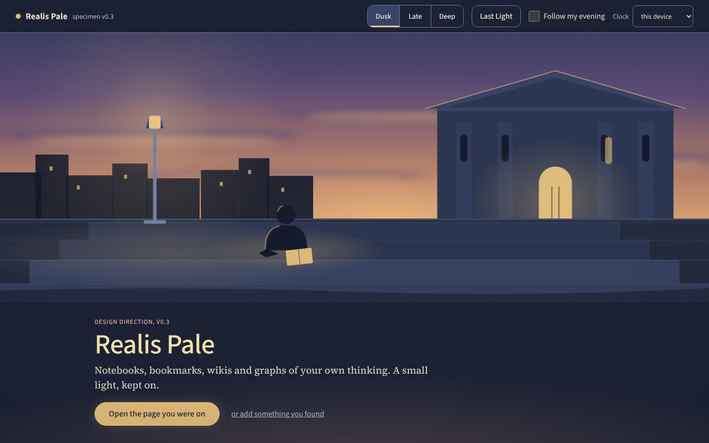
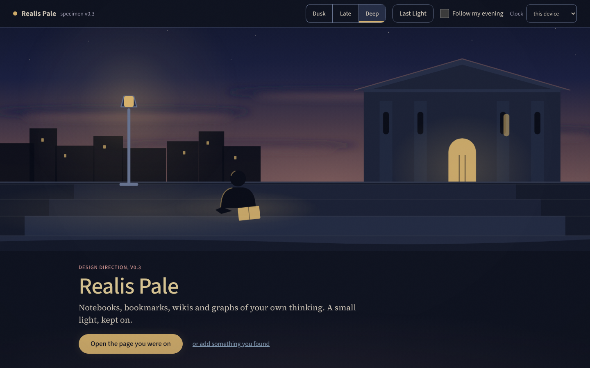
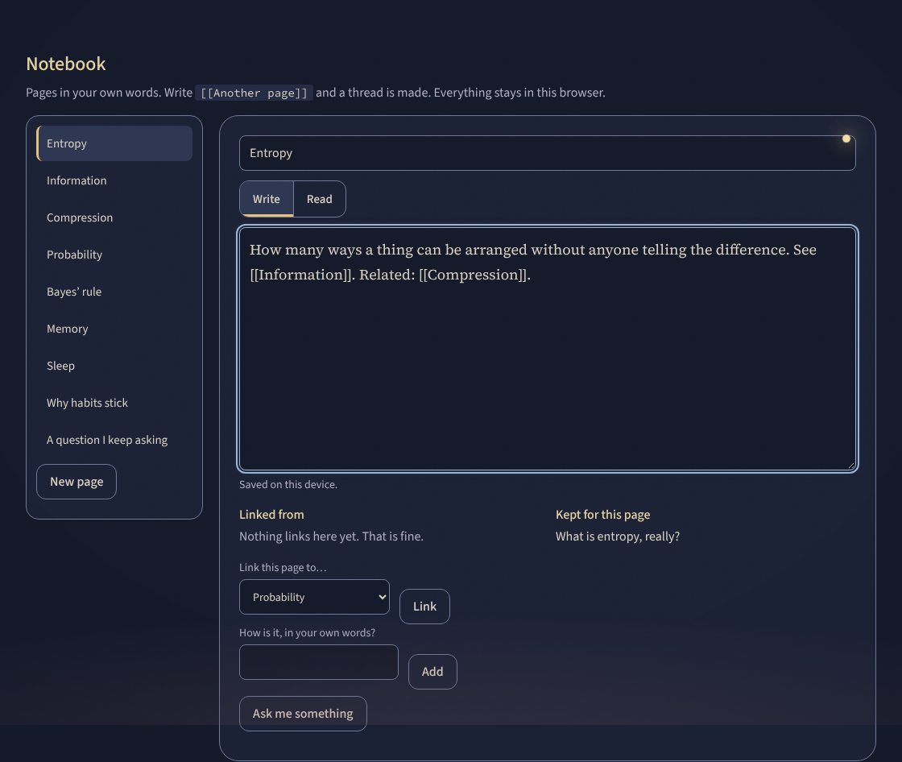

# REALIS PALE: Design Direction v0.3

> *6:40 PM, late in the year. The light has mostly gone from the sky but not
> all of it: a pale band stays along the roofline. On the steps outside the
> library someone has a notebook open on their knee, reading by the lamp over
> the door and by the glow of a phone turned low. Nobody is checking. Nobody is
> waiting for an answer. The page is slow going, and they are still on it.*
>
> *That is Realis Pale.*
>
> *1:15 AM, the same person, inside now. The room is lit by one lamp turned low.
> The notebook is a mess of arrows and half sentences, and in the middle of it
> two ideas that had nothing to do with each other have just touched. There is a
> small, brief light where they met. Then it is dim again, and they go on
> reading.*

**The vision, in four movements.** *Solitude*: it is done alone, with nobody
watching. *Resilience*: it is done again after a bad night, and again after a
gap. *Dim hope*: the light is low, and it is enough to see the next line.
*Contemplation*: the point is also to deal with yourself, to look at who you are
and what you know. The interface carries all four: dim light that follows the
hour, sparks when ideas meet, knowledge that is allowed to be chaos at the
person's own pace, and a place to be still.

| The vision says | The interface does |
|---|---|
| Late, in dim light, at the right time | Three hours of light, **Dusk, Late and Deep**, that dim with the evening if the person asks (section 3.6) |
| The sparkling of ideas | A **Spark**: one brief point of light where the person connects two things (section 11.1) |
| Chaos in knowledge, at your own pace | The **Graph** and the **Sketch**: knowledge laid out unordered, dark by default, with no required sequence (sections 11.2 and 11.6) |
| Dealing with yourself, contemplating yourself and your knowledge | The **Notebook**: private pages for the person's own words, with no scoring and no inference (section 11.3) |
| Resilience | The **Wick** marks returns, not streaks; every difficulty state leaves a way back (sections 10 and 14) |
| Solitude | Unobserved by default, owned by the person (section 14) |

**What it is for.** Realis Pale is for **personal knowledge tools**, where the person is
both the author and the only reader:

| Tool | The job | What Realis Pale adds |
|---|---|---|
| **Notebook** | Writing pages in your own words | Dim light that follows the hour, a page that is allowed to be blank, words of your own for how it is going |
| **Bookmarks (Keeps)** | Finding again what you found | An address plus *why you kept it*, never a fetched preview or a read count |
| **Wiki** | Pages that link to each other | Threads written in the text, backlinks, a trail of where you have walked |
| **Knowledge graph** | Seeing how what you know connects | A graph that opens mostly dark, is never arranged for you, and has a List with the same content |
| **Idea diagram (Sketch)** | Thinking in boxes and arrows | No imposed order; kinds of arrow told apart by their form, not their colour |

It is not a learning platform. Courses, lessons, grades, streaks and progress bars belong
to Ednocte's world and are left out on purpose (section 1.4).

Realis Pale is the quiet sibling of [Realis Aero](realis-aero.md). Realis Aero
is for systems that are measured and maintained in daylight. Realis Pale is for
the person who is trying to understand something, alone, after the day's
obligations have ended, with little certainty that it will work, and who keeps their
own notes, bookmarks and links to show for it. It keeps the
Realis rule that every optimistic cue is backed by something real, and applies
it to hope: **the hope in Realis Pale is the smallest light that is still on,
and it is never promised to be bigger.**

This document derives from Ednocte, the night-study direction in pull request
1. It keeps the person, the solitude and the outdoors, and it changes the hour,
the temperature, the light, the attitude and, from v0.3, the product: personal
knowledge tools, not education technology. Section 1 explains how.

---

## 1. Reading Ednocte, and what changes

### 1.1 What Ednocte says

Ednocte is a design philosophy for education technology built on eight
beliefs: learning does not belong to the classroom; the night belongs to the
curious; anonymity is freedom; feeling is part of the curriculum; the library
has dissolved into the air; ideas come from looking at lights; rogue means
asking no one's permission; and personal comes before scalable. Its image is a
person on a bench in an empty park at 11:47 PM, face lit by a phone, with neon
bleeding into wet asphalt. Its product vocabulary is Beacon, Route, Signal,
Booth, Window and Lamplight. Its palette is night blue with six neon accents,
its signature is depth as emitted light instead of shadow, and its voice is the
one awake friend, a little rogue and never a cheerleader.

### 1.2 The vision underneath, in detail

Seven ideas carry the file. They are what Realis Pale keeps.

| # | Idea in Ednocte | Why it matters to the vision |
|---|---|---|
| 1 | **Learning outside institutions** | Real learning is self-chosen and happens in the gaps: on the way home, on a bench, after hours. The product serves those moments, not a timetable. |
| 2 | **Solitude as the condition** | One person, one table, one hour. The design speaks to a single reader and refuses the average. |
| 3 | **No audience** | Anonymity is a relief. No name called, no hand raised, no grade waiting, and the strangers walking past are not watching. Privacy is the premise, not a setting. |
| 4 | **Feeling is the medium** | Loneliness, ambition and hunger are acknowledged instead of designed away. The product behaves like the one awake friend, not like software. |
| 5 | **Self-direction** | No gatekeeper decides what is worth wondering about tonight. Learning that serves no requirement is the purest kind. |
| 6 | **Light that means something** | Vast calm dark and rare points of glow, each one meaningful. Nothing glows for decoration. |
| 7 | **Restraint in reward** | No confetti, no guilt streaks, no XP. Warmth when the person is low-lit, quiet when they need quiet. |

Three tensions in the original are worth naming, because Realis Pale resolves
them differently.

1. **Defiance versus tenderness.** Ednocte frames solitary study as *rogue*:
   rebellion with taste, neon, an edge. That fits someone who is escaping
   something. It fits less well someone who is simply tired, unsure and
   persevering. The mood Realis Pale wants is not defiance but *persistence
   without witnesses*.
2. **Brightness versus hope.** Ednocte's hope is lit neon: cyan at 11:1,
   magenta flares, glows up to 64px. That is stimulating, and it can read as
   energy rather than as hope. Hope that is dim is a different feeling: the
   light is low and may be all there is, and it is enough to see the next line.
3. **A city of other minds versus being unseen.** Ednocte borrows comfort from
   lit windows, as proof that other people exist. Realis Pale keeps the windows
   but does not lean on them: the comfort is that no one needs to be watching,
   not that someone is.

### 1.3 What Realis Pale keeps, changes and drops

| | Ednocte | Realis Pale |
|---|---|---|
| **Product** | Education technology: courses, lessons, streaks, a learner and a platform | Personal knowledge tools: notebook, bookmarks, wiki, graph, sketch. One person, their own material. |
| **Hour** | After midnight: 11:47 PM, 2 AM | Dusk into the small hours. Three hours of light, Dusk, Late and Deep, that dim as the night goes on, at the person's choice. |
| **Place** | Park bench, diner booth, wet city street | Library steps, bus shelter, a balcony, a park path, a school wall. Quiet edges of a town, lit by one lamp. |
| **Attitude** | Rogue, rebellious, off-map | Unobserved, unhurried, unpressured. Persistence, not rebellion. |
| **Light** | Neon: cyan, magenta, violet, 6 accents, glows to 64px | Lamp and sunset: pale amber, a rose-amber horizon and a violet sky, 3 working accents plus 2 quiet ones, glow capped low |
| **Surfaces** | Near-black night blue (`#070A12` and up) | A visible dusk blue with violet in it (`#1B2133` and up): lighter, softer, never black, so the sunset stays in the picture |
| **Hope** | Energy and ignition | A small steady flame: *Kindle*, not *ignite*. Ideas arrive as brief sparks. |
| **Effort** | Ambition at midnight | Slow, honest effort: progress shown as what is lit, never as what is missing. Knowledge is a Graph that may be a mess. |
| **Motion** | Light sweeps, neon flicker | Slower and gentler: kindling, a slow breath, a path drawing itself |
| **Reward** | Lamplight streak that fades | A *Wick* that marks returns, dims and never goes out, with no loss messaging. A *Spark* belongs to the idea, not to a score. |
| **Voice** | Late-night, a little rogue | Evening, plain and kind, a little tired, never cheerful on command |
| **Typography** | Space Grotesk, Inter, Source Serif 4, JetBrains Mono | Source Sans 3, Source Serif 4, Source Code Pro (all three are bundled in this repository) |
| **Kept as it was** | Anonymity as a premise, depth as light and not shadow, one accent per region, serif for reading and sans for the interface, nothing glows for decoration, an exit that is always visible, no gamification spam, accessibility as a hard gate | |

What is dropped on purpose: neon, cyberpunk cues, wet pavement and glitch,
flicker, the rotated rogue sticker, magenta "flare" and cyan as a brand colour,
and the `dusk` colour that Ednocte itself had to restrict because it failed
contrast for body text.

### 1.4 From education to personal knowledge

In v0.1 and v0.2 this direction followed Ednocte into education technology: learning paths,
lessons, a person studying. Version 0.3 moves it to the tools a person uses for their own
thinking, which is where its mood fits best. Three things follow.

1. **The person is the author.** In an education product the material comes from outside and
   the person progresses through it. In a notebook, a wiki or a graph the material is the
   person's own, so there is nothing to grade, finish or catch up on. Progress, completion,
   scores and "learner" language go; ownership comes in.
2. **Structure is made by use.** A course is ordered in advance. A personal graph is made by
   writing: a link written in the text *is* the thread. So the Graph is derived from the
   pages, never maintained separately.
3. **The vision is unchanged.** Solitude, resilience, dim hope, knowing at your own pace and
   dealing with yourself all apply more directly to a notebook at night than to a course.

| Ednocte or Realis Pale v0.2 | Realis Pale v0.3 |
|---|---|
| Route, Path (progress along a course) | **Trail**: the pages you have walked through, lit as far as you have been |
| Window, Pane (a dashboard card) | **Pane**, for a page in progress or a Keep |
| Booth, Bench (focus mode) | **Bench**: reading a page with nothing else on screen |
| Lamplight, Wick (consistency) | **Wick**: coming back, never a streak |
| Field (knowledge, scattered) | **Graph**: pages and the threads between them |
| Still (a private page) | **Notebook**: every page is private; there is no other kind |
| (new) | **Keep**, **Thread**, **Sketch** |

---

## 2. Manifesto

**Realis Pale** = *Realis* (the feasible, the real) + *pale* (the colour that is
left when the light is going, and the state of a thing that is not yet lit).

A design direction for the tools a person uses to hold their own thinking: notebooks,
bookmarks, wikis, knowledge graphs and idea diagrams, used alone, in the evening and
late, with no one supervising and no deadline pressing, by someone who keeps going
anyway.

### The ten beliefs

**1. No one is watching, and that is a gift.**

There is no teacher on the other side of the screen, no cohort ahead of you, no
score being kept for someone else. The first thing the product owes the person
is that it is on their side of the table. What they read, how slowly they read
it and what they get wrong are not reported to anyone. Where a product must
share something, it says so plainly, asks first and makes the default private.

**2. The late hours are the person's own.**

The day was borrowed: work, school, errands, other people's calendars. When it
ends there is a stretch, the light low and the obligations done, that is
finally theirs. It begins at dusk and can run into the small hours. It is not
glamorous. It is the walk home that goes the long way, the bench near the
station, the table by the window, the lamp left on after everyone has gone to
bed. Realis Pale is built for those hours, and the light should follow them: the
later it gets, the dimmer the screen, so that it never competes with the night.
It does not ask the person to stay up to earn anything.

**3. Your pace is the pace.**

There is no right speed. A page that takes forty minutes is a page read. The
product never tells someone they are behind, because there is no "ahead" to be
behind. It offers where they left off, a gentle estimate of the next small step,
and a way to stop without loss. A deadline exists only if the person set it.

**4. Hope is a small light, and a small light is enough.**

The mood is dim hope: not triumph, not despair, not cheer. One lamp is on. It
shows the next line, the next problem, the next step of the path. The interface
is honest that the light is low and does not pretend it is dawn. Every screen
has one thing lit, and that one thing is true.

**5. Learning is also a way of facing yourself.**

To study alone late is also to spend time with yourself: your doubts, your
patience, what you do not yet understand and what you are surprised to know. The
product leaves room for that. It offers a quiet page for the person's own words
and lets them look at where they were and where they are, without a score
between them. It does not read their mood from their behaviour, and it does not
tell them what they feel.

**6. Effort is worth seeing, not grading.**

Trying hard alone is lonely work with little feedback. The product's job is to
make real effort visible to the person who is making it, as a path that is
lit as far as they have walked, and nothing else. It does not rank, compare or
reward. It notices.

**7. Knowledge is allowed to be a mess.**

Nobody learns in the order the syllabus is written. Understanding arrives in
scraps: a half-grasped idea, a gap, a sudden link back to something read months
ago. The product does not insist on a staircase. It lets the person lay what they
know out as they like, leave parts dark, and tidy only if they want to. The mess
is theirs, and so is the pace at which it settles into sense.

**8. Struggle is part of the material.**

Confusion, tiredness and a second attempt are not errors to be designed away
or cheered through. A hard page is a hard page. The product leaves room for
it: no timers counting down, no forced encouragement, no "you've got this!" that
the person has not asked to hear. When it speaks, it speaks plainly.

**9. Light that means something.**

The dusk is mostly dim and a few things glow. Each glow is a decision: this is
where you are, this is what you can act on, this is what you have done. Nothing
glows for decoration. The interface does not decorate with light; it *means*
with it.

**10. Personal before scalable.**

This direction is for one person, one bench, one evening. It does not try to be
tolerable to everyone. It is unmistakable to the few who know exactly what it is
to reread a paragraph under a lamp when no one would ever know if they gave up.

### Compressed: the seven working principles

1. **Unobserved by default.** Nothing about a person's learning is reported,
   ranked or shown to anyone without their say.
2. **Their pace, their hour.** No deadlines the person did not set, no "behind";
   the light follows the hour only if they ask it to.
3. **One lamp on.** One lit thing per region; hope is the smallest true light.
4. **Sparks belong to ideas.** A brief light where the person made a link, never
   for a score or for time spent.
5. **Chaos with craft.** Knowledge may be scattered and dark in places; the chrome
   around it stays steady.
6. **Effort is noticed, not graded.** Progress is shown as what is lit.
7. **Plain and kind.** The late voice: no cheering on command, no alarm, no guilt.

### Product vocabulary (use these names in the product)

| Name | Meaning | Replaces (Ednocte) |
|---|---|---|
| **Lantern** | Primary action: the lit sign that says "continue here" | Beacon |
| **Notebook** | The person's pages, in their own words; every page is private | (new) |
| **Page** | One note or wiki entry, with a title and text | (new) |
| **Thread** | A link between two pages, written in the text as `[[Another page]]` | (new) |
| **Keep** | A bookmark: an address and the person's own line about why they kept it | (new) |
| **Graph** | Pages and their threads, laid out as the person likes, dark by default | Route |
| **Trail** | The pages walked through, in order, lit as far as the person has been | Route |
| **Sketch** | An idea diagram: boxes and arrows with no order imposed | (new) |
| **Pane** | A card: a page in progress, a Keep | Window |
| **Wick** | Coming back: a small flame that marks returns and is still there after a gap | Lamplight |
| **Spark** | The moment two ideas meet: one brief point of light, then the thread stays | (new) |
| **Glimmer** | A notification: a faint, brief light, off by default | Signal |
| **Bench** | Reading a page with nothing else on screen | Booth |
| **Hour** | How dim the light is: Dusk, Late or Deep | (new) |

---

## 3. Colour System

### 3.1 Surfaces: the dusk (about 60%)

Never black. The sky just after sunset is a blue with violet in it, and the surfaces keep
that colour: a visible twilight, not a cave. Layers rise a little in lightness, the way
ground rises toward the roofline. Dusk surfaces are deliberately lighter and bluer than a
night theme, so that the screen feels dim and the scenery is not swallowed by the dark.

| Token | Hex | Role |
|---|---|---|
| `evening` | `#1B2133` | App background |
| `shade` | `#232A3E` | Base surface: cards, sheets, bars |
| `overcast` | `#2C3550` | Raised surface: popovers, hover |
| `fog` | `#374262` | Highest surface: pressed and selected |
| `mist` | `#7380A0` | Borders, control edges, dividers |

### 3.2 Text: what the lamp reaches (about 30%)

Text is not one white. Four colours do four jobs, so that the page has a hierarchy of
warmth and not only of size:

- `paper` is **warm parchment** for reading text: cream, never white.
- `heading` is **pale gold**, the colour of lamp light on a page, for headings and the
  one thing a region is about.
- `ash` is **dusk lilac**, for secondary text and captions.
- `haze` is a quieter lilac for timestamps and placeholders.

| Token | Hex | Role | on `evening` | on `shade` | on `overcast` | on `fog` |
|---|---|---|---|---|---|---|
| `paper` | `#E9DFCF` | Reading text | 12.14 | 10.81 | 9.19 | 7.52 |
| `heading` | `#F3DFAE` | Headings | 12.18 | 10.85 | 9.22 | 7.54 |
| `ash` | `#C0BCD0` | Secondary text, captions | 8.65 | 7.71 | 6.55 | 5.36 |
| `haze` | `#B3AECB` | Tertiary: timestamps, placeholders | 7.50 | 6.68 | 5.68 | 4.64 |

Every text colour reaches 4.5:1 on every surface, so no tier needs a restriction.
Contrast is a ratio computed from the hex values with the WCAG formula; it is not a
statement about how the screen looks outdoors in the evening.

### 3.3 Light: the glow (about 10%)

The accents are lamps. Fewer than in Ednocte, and softer.

| Token | Hex | Meaning | on `evening` | on `shade` | on `overcast` |
|---|---|---|---|---|---|
| `lantern` | `#EBC57E` | Hope and the primary action: lamp light, pale amber | 9.77 | 8.71 | 7.40 |
| `skyline` | `#A3BEDA` | Interactive and informational: the last of the sky | 8.33 | 7.43 | 6.31 |
| `lichen` | `#A9C3A3` | Done, steady, calm success | 8.40 | 7.49 | 6.36 |
| `rose` | `#E3A6A1` | Difficulty and errors: dusty, never alarm red | 7.80 | 6.95 | 5.91 |
| `wisp` | `#BDB0E0` | Generative or assistive features | 7.97 | 7.10 | 6.03 |

- **Text on a filled accent**: `evening` on `lantern` is 9.77:1 and `evening`
  on `skyline` is 8.33:1. A filled control uses the dark surface for its label,
  never white.
- **Edges and controls** use `mist`: 4.06, 3.62, 3.07:1 on `evening`, `shade` and
  `overcast`, above the 3:1 that non-text parts need. Borders on `fog` are not specified;
  a pressed control carries a `lantern` or `skyline` edge.
- **Surface steps are subtle on purpose**: `shade` over `evening` is 1.12:1, `overcast` over `shade`
  is 1.18:1 and `fog` over `overcast` is 1.22:1. A layer is told apart by its edge or
  its light, never by lightness alone, and that is a known limit of dim palettes.

### 3.4 Usage rules

- **60-30-10, adapted**: 60% dusk surfaces, 30% text and structure, 10% light.
- **One lit thing per region.** Usually `lantern` or `skyline`; the rest is
  punctuation. The one exception is the Spark (section 11.1): a brief light the
  person's own action causes, which passes and does not count as a lit thing. A screen with three bright things has no light, only noise.
- **Accents are never body text colour.** They mark action, state and life.
- **Meaning never rests on colour alone**: pair every accent with a shape, a
  label or a position. `rose` and `lichen` must never be the only difference
  between a good and a hard state.
- **Errors stay calm**: `rose` plus plain copy that says what happened and what
  can be done. The evening does not raise its voice.

### 3.5 Last Light: the daytime variant

A light variant exists for daylight, for print and for people who read better
on pale. It is not a white classroom: it is warm paper at the end of the day, with
the same sunset in the picture. Same accents' roles, same soul. Glow is off in Last
Light, because a glow on pale paper adds nothing; edges and focus rings carry state.

| Name | Token | Hex | Role |
|---|---|---|---|
| linen | `evening` | `#ECE8DF` | Background |
| parchment | `shade` | `#F5F2EA` | Base surface |
| stone | `overcast` | `#DDD8CC` | Inset wells only |
| ink | `paper` | `#1D2432` | Reading text |
| umber | `heading` | `#5A3B0B` | Headings |
| ink-soft | `ash` | `#444E60` | Secondary text |
| ink-faint | `haze` | `#5B6577` | Tertiary text |
| amber | `lantern` | `#7C5410` | Lantern text and marks |
| sky | `skyline` | `#2C5780` | Interactive text and marks |
| moss | `lichen` | `#3F6A3F` | Done |
| clay | `rose` | `#8A3F3B` | Difficulty and errors |
| wisp | `wisp` | `#5B4B8A` | Generative or assistive features |
| edge | `mist` | `#767E90` | Borders and control edges |

| Pair | `linen` | `parchment` | `stone` |
|---|---|---|---|
| `ink` | 12.72 | 13.90 | 10.93 |
| `umber` | 8.32 | 9.09 | 7.15 |
| `ink-soft` | 6.86 | 7.50 | 5.90 |
| `ink-faint` | 4.81 | 5.25 | 4.13 |
| `amber` | 5.48 | 5.99 | 4.71 |
| `sky` | 6.17 | 6.75 | 5.31 |
| `moss` | 5.13 | 5.61 | 4.42 |
| `clay` | 6.02 | 6.58 | 5.17 |
| `wisp` | 6.09 | 6.66 | 5.24 |
| `edge` | 3.33 | 3.64 | 2.86 |

- **Rules from the table**: `stone` carries only `ink`, `ink-soft`, `umber`, `amber`, `sky`, `clay`
  and `wisp`; `ink-faint` and `moss` sit on `linen` or `parchment`; edges are drawn on `linen` or
  `parchment` only. `ink` on the `lantern` fill is 9.60:1.
- Layers are 1.09:1 (`parchment` over `linen`) and 1.27:1 (`stone` over
  `parchment`), so edges and light, not lightness, separate them here too.

### 3.6 Dimming by the hour

Dusk (sections 3.1 to 3.3) is the default. Two dimmer hours follow it. Each lowers the
luminance of surfaces, text and light together, so the screen gets quieter as the night
goes on, and each is held to the same contrast gates. They are values for the same token
names; a component does not know which hour it is in. The sky (section 3.7) dims with
them, and does not go out.

| Token | Dusk | Late | Deep |
|---|---|---|---|
| `evening` | `#1B2133` | `#151A2B` | `#0F1320` |
| `shade` | `#232A3E` | `#1C2236` | `#151A2A` |
| `overcast` | `#2C3550` | `#242B44` | `#1C2236` |
| `fog` | `#374262` | `#2E3752` | `#252D45` |
| `mist` | `#7380A0` | `#6D7A99` | `#66728F` |
| `paper` | `#E9DFCF` | `#DCD2C2` | `#CCC3B5` |
| `heading` | `#F3DFAE` | `#E5D0A0` | `#D4C190` |
| `ash` | `#C0BCD0` | `#B1AEC2` | `#A19EB3` |
| `haze` | `#B3AECB` | `#A6A2BD` | `#9793AF` |
| `lantern` | `#EBC57E` | `#E4BF78` | `#D4B06C` |
| `skyline` | `#A3BEDA` | `#98B4D0` | `#8AA6C0` |
| `lichen` | `#A9C3A3` | `#9FB99A` | `#93AD8F` |
| `rose` | `#E3A6A1` | `#D9A09B` | `#CC928F` |
| `wisp` | `#BDB0E0` | `#B3A6D6` | `#A69BC7` |

Contrast, computed from these values (lowest in each group):

| Pair | Dusk | Late | Deep |
|---|---|---|---|
| `paper` on `evening`, `shade`, `overcast`, `fog` | 7.52 | 7.87 | 7.82 |
| `heading`, lowest on those four surfaces | 7.54 | 7.77 | 7.68 |
| `ash`, lowest on those four surfaces | 5.36 | 5.44 | 5.23 |
| `haze`, lowest on those four surfaces | 4.64 | 4.78 | 4.62 |
| `lantern`, `skyline`, `lichen`, `rose`, `wisp`, lowest on `evening`, `shade`, `overcast` | 5.91 | 6.21 | 6.07 |
| `mist` on `evening`, `shade`, `overcast` (non-text, 3:1) | 4.06, 3.62, 3.07 | 4.03, 3.68, 3.25 | 3.85, 3.60, 3.28 |
| `evening` on `lantern` (filled Lantern label) | 9.77 | 9.90 | 9.02 |

- **The light gets dimmer, the text stays readable.** Text never drops below 4.5:1
  at any hour; the figures above are the floor. Dimming is not allowed to buy
  atmosphere with legibility.
- **Surface steps are even subtler**: the layers differ by 1.06 to 1.17:1 at Late
  and Deep, so edges and light, not lightness, separate them, as before.
- **The glow scales with the hour**: glow alphas are multiplied by 1.0, 0.8 and
  0.6 at Dusk, Late and Deep, and motion durations by 1.0, 1.25 and 1.5. The later
  it is, the fewer and slower the lights.
- **How the hour is chosen.** The person chooses it by hand, from the Hour control,
  and that is the default. A person can also turn on *Follow my evening* and set
  the times (suggested: Late from 21:00, Deep from 23:30), and the product then
  moves to the next hour with a 20-minute cross-fade, never a jump. It uses the
  device clock and the person's own choices. It does not claim to know how bright
  the room is: a web page generally cannot read an ambient light sensor, and
  brightness belongs to the device.
- **Hours are not a lock.** Any hour can be set at any time of day; a person who
  studies in a bright room at noon is not corrected.
- **Last Light** (section 3.5) is the daytime variant, not an hour.

### 3.7 The sky

The scenery is part of the design. A dark theme must not minimise it, so the sky has its
own tokens, used only by illustrations and atmosphere and never behind text: a zenith, the
violet between, the low rose-amber, and the glow of a sun that has just gone.

| Token | Dusk | Late | Deep | Last Light |
|---|---|---|---|---|
| `sky-top` | `#2A3558` | `#1A2140` | `#10152A` | `#EAD9C4` |
| `sky-mid` | `#5B4A74` | `#35305A` | `#1B2040` | `#F0CFAF` |
| `sky-low` | `#B8806A` | `#7A5560` | `#55404A` | `#F0B88C` |
| `sky-glow` | `#E8B77A` | `#B88A6A` | `#7A5A5A` | `#F7D9A8` |

- **Hours are stages of one sunset.** Dusk is the sunset itself: a visible band of rose and
  amber over a violet sky. Late is twilight, the colour already draining. Deep is the
  last warm trace along the horizon, with stars. It gets dimmer; it does not go out.
- **A check holds it**: at Dusk the horizon is at least four times as bright as the surface;
  the horizon is warm and the zenith cool at every hour; the sky brightens toward the
  horizon and the sunset fades with the hour; and the same is measured in the painted
  picture, not only in the tokens.
- `--rp-stars` sets how many stars show (0.15, 0.3, 0.5 at the three hours).
  `--rp-silhouette` is the dark of people, roofs and doors against the lit sky.
- A faint warm glow rises from the bottom of the page and the Graph's floor, in the sky's
  low colour; it is decorative, removed under reduced transparency, and never behind text
  that is not on a surface.

---

## 4. Typography

Quiet, readable and warm. The system speaks in three voices:

| Role | Font | Where | Why |
|---|---|---|---|
| **Interface and display** | Source Sans 3 | Headings, controls, labels, numbers | A humanist sans: plain and unhurried. Already bundled in `fonts/` under the SIL Open Font License. |
| **Reading** | Source Serif 4 | Lessons, articles, long text | The book voice. Same designer family as Source Sans 3. Bundled in `fonts/` (Latin subset, variable weight, SIL Open Font License), declared in `fonts/realis-pale.fonts.css`. |
| **Code and IDs** | Source Code Pro | Code, shortcuts, timestamps | Bundled; digits share one width and confusable characters differ. |

**The rule**: *the interface is the path (sans), the knowledge is the lit page
(serif).* When the person is reading to learn, the serif takes over and the
chrome recedes.

### Scale (major third, base 16)

| Step | Size | Line height | Tracking | Font and weight |
|---|---|---|---|---|
| display | 40px | 1.15 | -1% | Source Sans 3 500 |
| h1 | 32px | 1.2 | -0.5% | Source Sans 3 520 |
| h2 | 24px | 1.3 | 0 | Source Sans 3 520 |
| h3 | 20px | 1.4 | 0 | Source Sans 3 520 |
| reading | 18px | 1.7 | 0 | Source Serif 4 400 |
| body-ui | 16px | 1.5 | 0 | Source Sans 3 400 |
| small | 14px | 1.5 | +1% | Source Sans 3 400 |
| caption | 13px | 1.4 | +2% | Source Sans 3 450, `ash` |
| mono | 14px | 1.5 | 0 | Source Code Pro 400 |

Evening reading comfort: reading text at 18px with line height 1.65 to 1.75, a
measure of 58 to 68 characters, and paragraph spacing of at least 1em. Never
justify text. The display step is lighter and smaller than a night-neon system's
would be, because this is a low voice.

---

## 5. Spacing, Grid, Shape

- Base unit **4px**, working rhythm **8px**.
- Component padding: 16 / 20 / 24. Screen gutters: 20px on a phone, 32px on a
  desktop.
- Section spacing is **generous**: 64px at least between major sections. The
  emptiness is part of the mood: a quiet street.
- Mobile first. The phone on a bench or a bus shelter is the primary context:
  one-handed, thumb reach, low brightness. Desktop is the table by the window:
  same light, more air.
- Grid: 4 columns on a phone, 8 on a tablet, 12 on a desktop, 24px gutters. There
  is **no rogue element**: the page keeps its grid, because the mood is steadiness.

### Radius

| Token | Value | Use |
|---|---|---|
| `sm` | 8px | Tags, chips, inputs |
| `md` | 12px | Buttons, small cards |
| `lg` | 16px | Cards, sheets |
| `xl` | 24px | Modals, hero panels |
| `pill` | 999px | Lantern buttons, nav items, search |

Radii are soft everywhere, because dusk light diffuses.

---

## 6. Elevation and Glow: a dim light, not a shadow

Depth is shown as **emitted light**, not grey shadow, as in Ednocte; a grey
shadow on a dusk surface reads as dirt. Here the light is *low*: glows are warm,
small, and capped, so that nothing ever reads as neon.

Three mechanisms, in order:

1. **Surface lift**: one step up the surface scale (`shade` to `overcast`).
2. **Edge light**: a 1px top-inner highlight, like lamp light on a ledge:
   ```css
   box-shadow: inset 0 1px 0 rgba(232, 228, 218, 0.05);
   ```
3. **Glow**: tinted by the element's accent, low alpha, never wider than 40px:

| Token | Value | Use |
|---|---|---|
| `glow-1` | `0 0 12px rgba(233, 199, 131, 0.14)` | Hover and focus on interactive parts |
| `glow-2` | `0 0 24px rgba(233, 199, 131, 0.20)` | The Lantern at rest, an active Pane |
| `glow-3` | `0 0 40px rgba(233, 199, 131, 0.26)` | The one moment of arrival: a path finished |
| `glow-sky` | `0 0 12px rgba(157, 186, 214, 0.16)` | Focus on informational parts |
| `glow-spark` | `0 0 16px rgba(244, 221, 166, 0.30)` | The Spark only (section 11.1) |

- **Focus rings**: `2px solid` accent plus `glow-1`. Focus is never removed; in a
  dim interface, focus is the light.
- A glow is never the only thing that marks a state: it comes with a shape or a
  label. Whether the glows are visible outdoors in the evening has not been
  tested; the low alphas are a design choice, not a measurement.

---

## 7. Atmosphere

A flat dark surface feels sterile. Realis Pale surfaces carry a little *air*, and
only a little:

- **The sky**: the sunset in the illustrations and, as a faint warm glow, along the bottom
  of the page and the floor of the Graph (section 3.7). It is the main atmosphere, not a
  band that dims away: the dusk must stay visible. Decorative, and never behind text that
  is not on a surface.
- **Grain**: SVG noise, 2% opacity at most, `mix-blend-mode: overlay`, fixed.
- **Vignette**: a radial darkening of the page edges by about 6%, one pool of
  lamp light.
- **Distant windows**: at most two small warm points (4 to 6px, blur 3px, 6% to 8%
  opacity) in the corners of a hero. Other people's lamps, far off, never the
  subject.

No bokeh orbs, no wet-pavement reflections, no light sweeps. All atmosphere layers
are decorative: `aria-hidden`, `pointer-events: none`, and removed under
`prefers-reduced-transparency`. A layer that can be *seen* as a layer is too loud.

---

## 8. Motion

The evening is slow. Motion is soft, weighted and rare.

| Token | Duration | Use |
|---|---|---|
| `fast` | 200ms | Presses, toggles, hovers |
| `base` | 400ms | Cards, sheets, fades |
| `slow` | 800ms | Path progress, page changes |
| `drift` | 1400ms | The slow breath of the Lantern |

Easing: `cubic-bezier(0.25, 0.6, 0.3, 1)`: a gentle decelerate, like coming to
rest.

**Signature motions**
- **Kindle**: active nav icons light gradually: stroke to fill with `glow-1` over
  400ms. Loading states kindle in the same way: a lamp warming, one slow rise,
  and then steady. Never a flicker, and it always resolves.
- **Breath**: the Lantern at rest eases between full and 0.82 opacity over about
  4 seconds. It is the only continuous motion in the product, and it stops when
  the person is reading.
- **Path draw**: progress paths draw themselves with `stroke-dashoffset`, 800ms.
- **Dusk change**: switching between Pale and Last Light cross-fades surfaces over
  `slow`; it never flashes.

- **Spark**: see section 11.1. It is the one fast, small light in the system, and it
  is always caused by the person.

At the later hours the durations in this table are multiplied (section 3.6).

Under `prefers-reduced-motion`, kindle and path draw become a 100ms opacity
change, and breath stops: the Lantern stays at full opacity. The evening is still
there; it just stops moving.

---

## 9. Iconography

- Style: **outlined, 1.5px stroke, rounded caps and joins**: unlit lamps.
- Grid: 24 by 24, 2px padding, live area at least 20 by 20.
- **The lamp rule**: the default state is an outline in `ash`. The active state is
  filled, in an accent, with `glow-1`. The lamp is lit by state, never by default.
- No duotone, no filled-by-default icons. Pair icons with labels below 44px; icons
  alone only in the bottom nav, which carries labels.

---

## 10. Components

### Lantern (primary action)
- Pill, `lantern` fill, `evening` label, Source Sans 3 520, 48px tall on a phone
  and 44px on a desktop. Label: *Continue*, *Begin*, *Pick it up*.
- Hover: `glow-2` and brightness 1.04. Press: scale 0.985 and `glow-1`.
- Only **one** Lantern per view. If everything is a lantern, there is no light to
  walk toward.

### Pane (card)
- `shade` surface, 1px `mist` border, radius `lg`, padding 20px.
- Hover: surface to `overcast`, `glow-1` in the card's accent.
- *Lit* variant: a 3px `lantern` bar on the inline-start edge as a real border,
  for the one item that is in progress. Never more than one per list.

### Trail (where you have walked)
- Called the **Trail**: the pages walked through, in the order they were walked. One of three
  ways to look at pages (Graph, Trail and List, section 11.2). It is made by use and nothing
  is locked behind it.
- A dotted line (2px dots, 8px gap, `mist`), with a lamp-post node at every
  milestone.
- Walked nodes: filled `lantern` with `glow-1`. The current node: `skyline`, with
  a slow breath. Nodes ahead: outline only. **The trail is lit as far as the person
  has walked, and no further.** There is no count of what is left, no percentage
  by default and no estimate of time behind them.

### Wick (coming back)
- A small flame mark and a strip of recent nights. A night with effort is warm
  (`lantern`, opacity 0.9); a quiet night is dimmer (0.4). It dims, it never
  shatters, and the dimmest state is still visible.
- **It counts returns, not consecutive days.** Resilience is coming back after a
  bad night or a gap, so the Wick shows *that the person returned*, in private,
  and nothing about how long they were away. It never says what was lost.
  Returning shows the flame where it was: *"Still here."*

### Glimmer (notification)
- **Off by default.** No badges, no red dots, no sound, and nothing at all in the
  hours the person has marked as theirs unless they ask for it.
- When allowed: a faint `glow-1` on the nav icon, one slow pulse, then rest. The
  content appears in an `overcast` sheet, radius `xl`, sliding up over 400ms.
- No Glimmer ever says "you're falling behind", nor counts days.

### Bench (focus mode)
- Full-screen `evening`, chrome fading to 30% after 4 seconds idle, serif reading
  type at 18px, measure 62 characters, optionally a faint lamp glow at the top.
- The exit is always visible. The bench is a choice, never a trap. No countdown,
  no break reminders unless the person turned them on.

### Inputs
- `evening` field on `shade`, 1px `mist`, radius `sm`, 48px tall.
- Focus: border to `skyline`, `glow-sky`, label rises in `skyline`.
- Placeholder: `haze`. Error: `rose` border plus plain copy below the field.

### Empty states
- A small line illustration (1.5px, `ash`): an empty bench under a lamp, a lit door
  at the top of some steps, a path that goes on past the edge.
- One line of plain copy and one action: *"Nothing here yet. It will be here
  when you come back."*

### Difficulty states
- When a person answers wrongly or leaves a page unfinished: no red flash, no
  buzzer. `rose` mark, a label ("Not yet"), and a way to look again. A hard
  evening is allowed.

---

## 11. Ideas, Chaos and Contemplation

The three things that make this direction about *knowing more*, and not only about
reading alone. Each is a rule for light, arrangement and silence.

### 11.1 Spark: the sparkling of ideas

An idea arrives as a small bright point, and the interface lets it. A **Spark** is
a brief light on the link the person has just made.

- **When it happens**: only when the *person* does something that is an idea
  meeting an idea: links two notes, restates something in their own words, marks
  "I see it now", or reopens an old note and ties it to a new one. It is never
  triggered by an answer being correct, by time spent, by a count or by the
  system's own guess.
- **How it looks**: a point of `spark` (`#F4DDA6`, 6 to 10px) that rises over 600ms
  and fades over 1400ms with `glow-spark`
  (`0 0 16px rgba(244, 221, 166, 0.30)`), and a hairline in `lantern` at 50%
  between the two ideas that stays. The flash passes, the link remains.
- **One at a time.** At most one Spark is visible. It does not stack, repeat or
  cascade, so that it stays rare enough to be felt.
- **No score.** Sparks are not counted, ranked, summarised or shown to anyone. There
  is no "ideas this week". The link is the record, and it belongs to the person.
- **No sound and no vibration by default.**
- **Reduced motion and assistive technology.** Under `prefers-reduced-motion` the
  Spark is a static small mark that stays on the link, without the rise and fade.
  The link has a text label (*"Linked: A and B"*), announced politely, so the
  moment is not carried by light alone.
- **The product never schedules a Spark.** Ideas follow the person; the product
  cannot promise one, and does not fake one.

### 11.2 Graph: chaos in knowledge, at your own pace

Knowledge is not a staircase. The **Graph** shows the person's pages as lamps on a quiet
plane, joined by the threads they have written, in whatever arrangement they like.

- **Made from the text.** A thread exists because the person wrote `[[Another page]]` in a
  page. The Graph is derived from the pages and never edited separately, so it cannot
  disagree with them. Renaming a page rewrites the links that point to it.
- **Dark is the default.** Pages not opened for a while are simply dark. They are not
  "incomplete", "locked", "stale" or "behind". Light is where the person has been, and a
  Graph mostly dark is not a failing one. There is **no orphan label**: a page with no
  threads says "No threads yet".
- **No required order.** Nothing is locked, no completeness percentage, no "x of y", no red
  marks for gaps.
- **Never arranged for the person.** Positions are theirs and survive a reload. There is no
  force-directed layout that moves things while they look. *Tidy* gathers related pages
  and keeps every thread; *Undo tidy* puts everything back exactly.
- **Chaos with craft.** The pages may scatter and overlap; the chrome around them, the grid,
  controls and navigation, stays steady, so the mess has a calm frame.
- **Kinds are told apart by form.** When a graph has more than one kind of thread, they
  differ by line style (solid, dashed, dotted) and a written label, never by colour alone.
- **Large graphs.** Past what a screen can show, show the pages around the one the person
  is on (a local graph), keep every label readable at the size it is drawn, and let the
  person search; never shrink labels to fit.
- **Three views of one thing**: **Graph** (scattered), **Trail** (the pages walked, in order)
  and **List** (flat, sortable by title). The same pages, threads and lit state appear in
  all three. **The List is mandatory** and is the accessible route: a spatial plane is hard
  to use with a keyboard or a screen reader, so the List carries the same content and the
  same actions. That equivalence is a requirement and has been tested only with a keyboard.
- **Pace is the person's.** Nothing decays or expires and nothing is rearranged without
  their say. A page untouched for a year looks exactly as it did.
- **Links are drawn, not inferred.** The product does not invent connections between the
  person's pages and present them as the person's own insight. A suggestion, if offered, is
  marked as one and can be dismissed.

### 11.3 Notebook: contemplating yourself and what you know

The **Notebook** is where the person deals with themselves: private pages in their own
words, one at a time.

- **Every page is private.** There is no shared page, no public page and no "visible to"
  setting. A product that also shares must do so in a separate surface, by the person's own
  act, and mark it.
- **What is on a page**: a title, text, and the threads, Keeps and words attached to it. A
  blank page is valid.
- **Write and Read.** Write is plain text with \`[[links]]\`. Read shows the same text with
  each link as a button; a link to a page that does not exist is shown as such, in words,
  and nothing is created until the person asks.
- **Linked from.** Each page lists the pages that link to it, or says "Nothing links here
  yet. That is fine."
- **Their names for how they feel.** The person may tag a page with words of their own
  (*stuck*, *tired*, *lost*, *quiet*). The words belong to that page, stay on it and are not
  analysed.
- **Open questions.** Questions such as *"What stayed with you?"*, *"What still doesn't
  fit?"* and *"What are you carrying tonight?"* appear only when the person asks for them.
- **Then and now** (specified, not built in the specimen): the person can place an earlier
  page beside a later one to see how their understanding or mood changed, with no score,
  grade or arrow between them.
- **No inference.** The product does not guess a mood from behaviour, typing speed or hours,
  does not run sentiment analysis on what is written, and does not adapt its voice to a
  guess about how the person feels. Reading someone's feelings from their behaviour is
  surveillance, and it contradicts the rest of this document.
- **The quietest surface.** In the Notebook at the Bench the lights are lowest, there is one
  lit thing (the page), motion is at its slowest and nothing needs dismissing.

### 11.4 Wiki pages and threads

A wiki page is a Notebook page the person has linked. Nothing else is added to it.

- **Threads are written, not clicked into being.** Typing `[[Title]]` makes a thread; the
  *Link this page to* control writes the same text, so the keyboard and the pointer make the
  same thing. Completing a new thread is the one thing that causes a Spark (section 11.1).
- **Backlinks are quiet.** *Linked from* lists titles. It does not rank, count or rate them,
  and it does not suggest links the person has not written.
- **Trail.** The pages the person has opened, in order, are the Trail. It is the person's
  own history, local to the device, and never summarised into "pages read" or "time spent".

### 11.5 Keeps: bookmarks in the person's words

A **Keep** is an address and a line of the person's own about why they kept it.

- **Nothing is fetched.** A Keep does not load the page, a preview image, a title or a
  summary; the person gives a name, or the host is used. Nothing about it leaves the device
  until the person follows the link, which opens in a new tab with no referrer and no
  opener.
- **No counters.** No "saved N times", no read count, no reading time, no "unread" badge.
- **Attached by the person.** A Keep belongs to a page if the person says so, and is listed
  on that page; a Keep with no page is allowed.
- **Forgetting is easy and real.** *Forget* removes a Keep; there is no archive the person
  has not asked for.
- **A bad address is refused in words**, with the field marked invalid, and nothing the person
  typed is lost.

### 11.6 Sketch: ideas in boxes and arrows

A **Sketch** is an idea diagram with no order imposed.

- **Free placement.** Boxes sit where the person puts them, by dragging or by the arrow keys,
  and stay there.
- **Two kinds of arrow, told apart by form.** A *leads to* arrow is solid with a head; a
  *might relate* line is dashed with none. Colour is never the only difference, so it survives
  forced colours and print.
- **Every arrow is also written out** ("Question leads to What I know") below the diagram,
  with a way to remove it, so the diagram has a text equivalent.
- **Boxes and arrows are made by the person.** The product does not generate or rearrange a
  diagram.

---

## 12. Imagery and Art Direction

- **Photography**: the evening outdoors: blue hour, a single lamp, lit stairwells,
  library steps, a bus shelter, a balcony with a book, rain on a window with a lamp
  behind it. People *absorbed*, not posing: seen from the side or behind, hands on
  a page. No eye contact with the camera, no group shots.
- **Treatment**: shadows pushed to `evening`, highlights warmed toward `lantern`.
  Low contrast, a little grain. The picture is dim on purpose and keeps its detail
  in the shadows.
- **Forbidden**: stock classrooms, whiteboards, smiling thumbs-up, graduation
  caps, white desks, lightning bolts and rocket ships. Also forbidden: neon,
  anything that implies victory, and crowds of encouraging faces.
- **Illustration**: the 1.5px line language of the icons, `ash` lines, one `lantern`
  glow per illustration at most.

---

## 13. Voice and Tone

Second person, evening, plain and kind. Short sentences. The product is the one
quiet person still up at the next table: warm, a little tired, never a
cheerleader, never a coach.

- ✅ *"Pick it up where you left off. Two pages in."*
- ✅ *"That one was hard. It will still be here."*
- ✅ *"You came back. The light was still on."*
- ✅ *"No one is waiting for this."*
- ❌ *"Amazing job!! 🎉 You've earned 50 XP!"*
- ❌ *"Don't lose your streak!"*
- ❌ *"You're 3 days behind your plan."*
- ❌ *"Join 12,000 learners studying right now!"*

Lowercase is allowed in ambient and empty-state copy for intimacy, and never in
actions, errors or anything that needs clarity. At most one emoji, never in a
system state. The product never speaks about the person's hope for them: it
offers a next step and lets the person feel what they feel.

---

## 14. Pressure-free and personal-use rules

These are the behavioural counterpart of the colour rules, and they are hard
gates in the same way. The first ten keep study pressure-free; the last six are what makes
a personal tool the person's own.

1. **No supervision channel.** No teacher, parent or manager view, no leaderboard,
   no peer comparison, no public profile, no "who else is studying" by default.
   Where a product has to report (a school, an employer), the report is disclosed
   before the person starts, is opt-in, and the person can see exactly what is
   sent.
2. **No clock the person did not wind.** No deadline, countdown, timer or "time
   left" unless the person set it. Estimates are offered as "about 10 minutes to
   the next lamp", never as "you should".
3. **No loss mechanics.** No streak that resets, no lost points, no message that
   names what was missed. Absence dims the Wick and nothing more.
4. **No scoring by default.** Answers are checked for the person's own
   information. A result is not a grade and is not stored for anyone else.
5. **Leave and return freely.** Closing mid-page saves the place. Coming back
   never opens with a reminder of how long it has been.
6. **Quiet by default.** Glimmers off, sound off, nothing in the person's own hours
   unless asked, and one switch turns all of it off.
7. **The exit is always visible.** Every focus view, sheet and flow can be left,
   and leaving never costs anything.
8. **No reading of feelings.** No mood inferred from behaviour, typing or hours, no
   sentiment analysis of what a person writes, and no adapting of the product's
   voice to a guess about how they feel. What a person says they feel is theirs.
9. **No imposed order.** Nothing is locked or hidden behind a sequence the person did
   not choose, and the product never presents a gap in what they know as a failing.
10. **Dimming is the person's.** The light follows the hour only when the person turns
    that on, and they can override it at any time.
11. **Owned.** Pages, Keeps and sketches are the person's, kept where they can reach them
    (on the device by default) and exportable in a plain, open format at any time.
12. **Local first.** The product works with no account and no network, and nothing is sent
    anywhere unless the person starts it.
13. **No tracking of reading.** No analytics on what is opened, how long, how often or in what
    order; no "recently read" fed to anyone; the Trail is only the person's own.
14. **No social layer.** No likes, followers, public profiles, feeds or comments; sharing is a
    separate, deliberate act with its own surface.
15. **No machine reading by default.** No automatic summary, tagging, linking or "insight"
    over the person's pages; any assistive feature is off until asked for, says what it will
    read, and its output is marked as not the person's.
16. **No lock-in.** Leaving costs nothing: export is complete (pages, threads, Keeps, sketches,
    tags) and the exported files can be read without the product.

These are product commitments, not visual properties. They can only be shown to
hold by testing a real product with real accounts; nothing in this document
verifies them.

---

## 15. Accessibility (non-negotiable)

Dim palettes fail accessibly by default. These rules are hard gates:

- Body text at least 4.5:1, large text at least 3:1, on every surface it can sit
  on. Every pairing in sections 3.2 and 3.3 reaches 4.5:1 on `evening`, `shade`
  and `overcast`; `haze` on `fog` is 4.71:1, the lowest text pair.
- Non-text parts (borders, icons, focus rings, control edges) at least 3:1 against
  the adjacent surface: `mist` gives 3.93, 3.55 and 3.11:1 on the three base
  surfaces.
- Accents are never the only carrier of meaning: pair with an icon, a label or a
  position.
- Focus is always visible: a 2px ring plus glow, with `:focus-visible`
  everywhere.
- Touch targets at least 44 by 44px, because it is one-handed, on a bench, in low
  light.
- `prefers-reduced-motion`, `prefers-reduced-transparency` and
  `prefers-contrast: more` are supported. Under more contrast, surfaces flatten to
  `evening` and `shade`, borders go to `paper`, and glows are replaced by 2px solid
  borders. Under forced colours, glows and atmosphere are removed and edges use
  system colours.
- Pale is the default; Last Light (section 3.5) passes the same gates with the
  figures shown there.
- Semantic HTML, real labels, and screen-reader text for any meaningful light.
  Atmosphere layers are hidden from assistive technology.
- **Sparks and the Graph** carry their meaning in text: the link's label for a Spark,
  and the mandatory List for the Graph (section 11.2). A change of hour is a
  cross-fade over 20 minutes, with no flash, and under reduced motion it is a single
  step the person is not surprised by.
- **Dim interfaces and brightness**: outdoors in the evening, an uncomfortably
  bright screen is the main failure. Pale supports a **lower-brightness mode**
  (all light tokens at 85% alpha, surfaces unchanged), which must still reach
  4.5:1. That contrast has not been computed yet; it is a gate before release.

---

## 16. Anti-patterns: what Realis Pale is NOT

1. ❌ A white or primary-colour classroom.
2. ❌ Neon, cyberpunk, glitch, scanlines: that is Ednocte's night, not this dusk.
3. ❌ Pure `#000` with bright text: halation and eye strain.
4. ❌ Gamification: XP, badges, confetti, countdowns, guilt streaks.
5. ❌ A corporate learning dashboard: a dozen KPI cards and a pie chart.
6. ❌ Grey drop shadows: depth is light, never fog.
7. ❌ More than one Lantern per view, or more than one lit thing per region.
8. ❌ Forced positivity: "You've got this!", motivational quotes, cheering.
9. ❌ Surveillance dressed as care: progress shared with anyone by default,
   "your teacher can see", activity feeds.
10. ❌ Noise for its own sake: grain and glow you can *see* as grain and glow.
11. ❌ Sparks as rewards: a Spark for a correct answer, for time spent, or one that is
    counted, repeated or shown to anyone.
12. ❌ A forced staircase: locked nodes, mandatory order, completeness bars, and red
    marks on what is not yet known.
13. ❌ Mood surveillance: guessing, scoring or displaying how the person feels.
14. ❌ Dimming by stealth: changing the light by the clock without the person having
    asked for it.

---

## 17. Design tokens: implementation

### CSS custom properties

This is a copy of [`tokens/realis-pale.tokens.css`](tokens/realis-pale.tokens.css), the
source of truth; `npm run check:pale` fails if the two differ.

```css
/* Realis Pale tokens, v0.2 (draft).
 * Dusk is the default. Late and Deep are dimmer hours of the same names, chosen by
 * data-hour on the root. Last Light is the daytime variant, data-theme="last-light".
 * Components use these names only, so they do not know which hour it is.
 * Contrast of every pair is computed by tools/check-pale.mjs and published in
 * realis-pale.md, section 3.6. */

/* Registered so that a change of hour can cross-fade instead of jumping. */
@property --rp-evening  { syntax: "<color>"; inherits: true; initial-value: #1B2133; }
@property --rp-shade    { syntax: "<color>"; inherits: true; initial-value: #232A3E; }
@property --rp-overcast { syntax: "<color>"; inherits: true; initial-value: #2C3550; }
@property --rp-fog      { syntax: "<color>"; inherits: true; initial-value: #374262; }
@property --rp-mist     { syntax: "<color>"; inherits: true; initial-value: #7380A0; }
@property --rp-paper    { syntax: "<color>"; inherits: true; initial-value: #E9DFCF; }
@property --rp-heading  { syntax: "<color>"; inherits: true; initial-value: #F3DFAE; }
@property --rp-ash      { syntax: "<color>"; inherits: true; initial-value: #C0BCD0; }
@property --rp-haze     { syntax: "<color>"; inherits: true; initial-value: #B3AECB; }
@property --rp-lantern  { syntax: "<color>"; inherits: true; initial-value: #EBC57E; }
@property --rp-skyline  { syntax: "<color>"; inherits: true; initial-value: #A3BEDA; }
@property --rp-lichen   { syntax: "<color>"; inherits: true; initial-value: #A9C3A3; }
@property --rp-rose     { syntax: "<color>"; inherits: true; initial-value: #E3A6A1; }
@property --rp-wisp     { syntax: "<color>"; inherits: true; initial-value: #BDB0E0; }
@property --rp-sky-top  { syntax: "<color>"; inherits: true; initial-value: #2A3558; }
@property --rp-sky-mid  { syntax: "<color>"; inherits: true; initial-value: #5B4A74; }
@property --rp-sky-low  { syntax: "<color>"; inherits: true; initial-value: #B8806A; }
@property --rp-sky-glow { syntax: "<color>"; inherits: true; initial-value: #E8B77A; }

:root {
  /* surfaces: a visible twilight, not black */
  --rp-evening: #1B2133;
  --rp-shade: #232A3E;
  --rp-overcast: #2C3550;
  --rp-fog: #374262;
  --rp-mist: #7380A0;
  /* text: warm paper for reading, pale gold for headings, dusk lilac for what is quieter */
  --rp-paper: #E9DFCF;
  --rp-heading: #F3DFAE;
  --rp-ash: #C0BCD0;
  --rp-haze: #B3AECB;
  /* light */
  --rp-lantern: #EBC57E;
  --rp-skyline: #A3BEDA;
  --rp-lichen: #A9C3A3;
  --rp-rose: #E3A6A1;
  --rp-wisp: #BDB0E0;
  --rp-spark: #F4DDA6;
  /* the sky: decorative, never behind text. Zenith, the violet between, the low rose-amber, and the glow of a sun that has just gone */
  --rp-sky-top: #2A3558;
  --rp-sky-mid: #5B4A74;
  --rp-sky-low: #B8806A;
  --rp-sky-glow: #E8B77A;
  --rp-stars: 0.15;
  /* the dark shapes in the illustrations: people, roofs, doors against a lit sky */
  --rp-silhouette: #141A2B;
  /* the label on a filled Lantern and the fill itself, so Last Light can differ */
  --rp-lantern-fill: #EBC57E;
  --rp-on-lantern: #1B2133;

  /* the hour scales glow and motion: 1, 0.8, 0.6 and 1, 1.25, 1.5 */
  --rp-glow-k: 1;
  --rp-time-k: 1;
  /* a real change of hour takes 20 minutes; a demo can shorten it */
  --rp-fade: 1200s;

  /* glow: light, not shadow */
  --rp-glow-1: 0 0 12px rgb(233 199 131 / calc(0.14 * var(--rp-glow-k)));
  --rp-glow-2: 0 0 24px rgb(233 199 131 / calc(0.20 * var(--rp-glow-k)));
  --rp-glow-3: 0 0 40px rgb(233 199 131 / calc(0.26 * var(--rp-glow-k)));
  --rp-glow-sky: 0 0 12px rgb(157 186 214 / calc(0.16 * var(--rp-glow-k)));
  --rp-glow-spark: 0 0 16px rgb(244 221 166 / 0.30);
  --rp-edge-light: inset 0 1px 0 rgb(232 228 218 / 0.05);

  /* type */
  --rp-font-ui: "Source Sans 3", "Noto Sans Arabic", system-ui, sans-serif;
  --rp-font-reading: "Source Serif 4", Georgia, serif;
  --rp-font-mono: "Source Code Pro", ui-monospace, monospace;

  /* space and shape */
  --rp-space: 4px;
  --rp-radius-sm: 8px;
  --rp-radius-md: 12px;
  --rp-radius-lg: 16px;
  --rp-radius-xl: 24px;
  --rp-target: 44px;

  /* motion */
  --rp-ease: cubic-bezier(0.25, 0.6, 0.3, 1);
  --rp-fast: calc(200ms * var(--rp-time-k));
  --rp-base: calc(400ms * var(--rp-time-k));
  --rp-slow: calc(800ms * var(--rp-time-k));
  --rp-drift: calc(1400ms * var(--rp-time-k));
}

:root[data-hour="late"] {
  --rp-evening: #151A2B; --rp-shade: #1C2236; --rp-overcast: #242B44; --rp-fog: #2E3752; --rp-mist: #6D7A99;
  --rp-paper: #DCD2C2; --rp-heading: #E5D0A0; --rp-ash: #B1AEC2; --rp-haze: #A6A2BD;
  --rp-lantern: #E4BF78; --rp-skyline: #98B4D0; --rp-lichen: #9FB99A; --rp-rose: #D9A09B; --rp-wisp: #B3A6D6;
  --rp-sky-top: #1A2140; --rp-sky-mid: #35305A; --rp-sky-low: #7A5560; --rp-sky-glow: #B88A6A; --rp-stars: 0.3; --rp-silhouette: #10152A;
  --rp-lantern-fill: #E4BF78; --rp-on-lantern: #151A2B;
  --rp-glow-k: 0.8; --rp-time-k: 1.25;
}
:root[data-hour="deep"] {
  --rp-evening: #0F1320; --rp-shade: #151A2A; --rp-overcast: #1C2236; --rp-fog: #252D45; --rp-mist: #66728F;
  --rp-paper: #CCC3B5; --rp-heading: #D4C190; --rp-ash: #A19EB3; --rp-haze: #9793AF;
  --rp-lantern: #D4B06C; --rp-skyline: #8AA6C0; --rp-lichen: #93AD8F; --rp-rose: #CC928F; --rp-wisp: #A69BC7;
  --rp-sky-top: #10152A; --rp-sky-mid: #1B2040; --rp-sky-low: #55404A; --rp-sky-glow: #7A5A5A; --rp-stars: 0.5; --rp-silhouette: #0A0D18;
  --rp-lantern-fill: #D4B06C; --rp-on-lantern: #0F1320;
  --rp-glow-k: 0.6; --rp-time-k: 1.5;
}

/* Last Light: warm paper at the end of the day. Same role names, new values.
 * Glow is off because a glow on pale paper adds nothing; edges and focus rings carry state. */
:root[data-theme="last-light"] {
  --rp-evening: #ECE8DF;   /* linen */
  --rp-shade: #F5F2EA;     /* parchment */
  --rp-overcast: #DDD8CC;  /* stone */
  --rp-fog: #DDD8CC;
  --rp-mist: #767E90;      /* edge */
  --rp-paper: #1D2432;     /* ink */
  --rp-heading: #5A3B0B;   /* umber */
  --rp-ash: #444E60;       /* ink-soft */
  --rp-haze: #5B6577;      /* ink-faint */
  --rp-lantern: #7C5410;   /* amber */
  --rp-skyline: #2C5780;   /* sky */
  --rp-lichen: #3F6A3F;    /* moss */
  --rp-rose: #8A3F3B;      /* clay */
  --rp-wisp: #5B4B8A;
  --rp-sky-top: #EAD9C4; --rp-sky-mid: #F0CFAF; --rp-sky-low: #F0B88C; --rp-sky-glow: #F7D9A8; --rp-stars: 0; --rp-silhouette: #2A2F3D;
  --rp-lantern-fill: #E9C783;
  --rp-on-lantern: #1D2432;
  --rp-glow-k: 0;
  --rp-time-k: 1;
}

@media (prefers-reduced-motion: reduce) {
  :root { --rp-time-k: 0.5; --rp-fade: 0.01s; }
}

/* More contrast: surfaces flatten, borders go to the text colour, glows become borders. */
@media (prefers-contrast: more) {
  :root { --rp-mist: var(--rp-paper); --rp-glow-k: 0; }
}

@media (forced-colors: active) {
  :root { --rp-glow-k: 0; }
}
```

In Last Light and at the dimmer hours the role names stay and the values change, so a
component written against `--rp-evening`, `--rp-paper`, `--rp-heading` and `--rp-lantern`
follows the theme. The filled Lantern uses `--rp-lantern-fill` with `--rp-on-lantern`, a
pair kept apart from `--rp-lantern` so that Last Light can darken the lantern's text and
marks while keeping a pale amber fill.

### DTCG / W3C JSON (excerpt)

```json
{
  "color": {
    "surface": { "evening": { "$value": "#1B2133", "$type": "color" }, "shade": { "$value": "#232A3E", "$type": "color" } },
    "text": { "paper": { "$value": "#E9DFCF", "$type": "color" }, "heading": { "$value": "#F3DFAE", "$type": "color" }, "ash": { "$value": "#C0BCD0", "$type": "color" } },
    "light": { "lantern": { "$value": "#EBC57E", "$type": "color" }, "skyline": { "$value": "#A3BEDA", "$type": "color" } }
  },
  "shadow": { "glow-1": { "$value": { "color": "rgba(233, 199, 131, 0.14)", "offsetX": "0px", "offsetY": "0px", "blur": "12px", "spread": "0px" }, "$type": "shadow" } }
}
```

For a full export in the Realis Aero style (three tiers, themes, a Tailwind preset
and a native module), the tokens above would be moved into a token file and run
through the same exporter; that has not been done.

---

## 18. Status, verification and limits

What was done:

- **Contrast**: every pair in sections 3.2, 3.3, 3.5 and 3.6 is computed from the
  token file, `tokens/realis-pale.tokens.css`, by `tools/check-pale.mjs`, and the
  figures printed in section 3.6 are checked against that computation, so the
  document and the tokens cannot drift apart without the check failing.
- **A specimen**, [`specimen/pale.html`](specimen/pale.html), built from the
  tokens: the three hours and Last Light, Follow my evening, the hero scene, the
  parts (Lantern, Pane, Wick, Glimmer, Trail), the Bench, the Notebook with Write and Read and threads, Keeps, the Graph with its Trail and
  List views, the Spark, Tidy and Undo, and the Sketch. Illustrations are drawn in code
  from the tokens ([`specimen/pale-art.html`](specimen/pale-art.html)).
- **188 checks in a real browser** (`npm run check:pale`), described in section 20.
  They were tested against defects: a text colour dimmed below 4.5:1, Sparks that
  stack, a second Lantern, a count written next to a link, and a removed focus ring
  each make them fail. The check also found a wrong figure in this document (6.48
  where the computed value is 6.47), which is corrected.

What has **not** been done, and should not be assumed:

- **Chromium only.** The specimen and its checks run in one browser engine, on a
  desktop and at a phone width, not on real phones, in Safari or Firefox, with a
  screen reader, or with a physical switch or keyboard other than the emulated one.
- **Dim readability outdoors is untested.** The numbers say a screen *can* be
  read; they say nothing about reading it in real evening light, at low
  brightness, with tired eyes. That needs people and devices.
- **Colour-vision simulation has not been run** on the accents. The accents are
  never the only carrier of meaning by rule, but their separability under
  deuteranopia and protanopia has not been measured.
- **The pressure-free rules (section 14) are commitments.** They can be verified
  only in a product, with real accounts, by checking what is sent and shown.
- **The hours are built and checked, not judged.** Dusk, Late and Deep pass the
  contrast gates and the specimen cross-fades between them, but whether the steps
  feel like the same light getting quieter, whether 20 minutes is the right
  cross-fade, and whether 21:00 and 23:30 suit anyone, are untested. The specimen's
  clock demo uses a 2.5 second fade so that it can be watched; the 20 minutes is
  only in the setting, and was checked by reading it, not by waiting.
- **The Spark is built, not proven.** It appears only on a link the person makes,
  one at a time, with words, and stays still under reduced motion. Whether a point
  of light that rises over 600ms and fades over 1400ms reads as an idea meeting an
  idea, or as a notification, or as nothing, has not been tried on anyone. In a
  real product the trigger (the person's own link) has to exist.
- **The Graph and the List are built and keyboard-tested, not screen-reader
  tested.** They carry the same nine items, links and lit state, and an item can
  be opened and linked with a keyboard alone. How they are announced by a real
  screen reader has not been listened to.
- **The Notebook and Keeps store nothing off the device**, which the checks confirm for the
  specimen (no request leaves the browser, a Keep's address included). Whether people want
  these tools made this way, and whether the open questions help or intrude, needs the people.
- **Export, import and sync are not built.** Rules 11, 12 and 16 (owned, local first, no
  lock-in) are commitments for a product; the specimen keeps data in the browser only and
  has no export, so it does not meet rule 11 yet.
- **The Sketch and the Graph are small.** Nine pages and five boxes say nothing about
  hundreds. The large-graph rules in section 11.2 are unbuilt and untested.
- **Then and now** (section 11.3) is specified and not built.
- **The dim hope mood itself is untested with people.** Whether the palette,
  motion and voice read as hope and not as sadness is a design hypothesis. It
  needs interviews with people who actually study this way.

---

## 19. Implementation checklist

- [x] Fonts loaded: Source Sans 3, Source Code Pro and Source Serif 4, all bundled
      (SIL Open Font License)
- [ ] Token layer shipped as CSS variables plus DTCG JSON; Tailwind theme generated
      from the tokens, as Realis Aero does
- [ ] Atmosphere as a single reusable layer, `aria-hidden`, off under reduced
      transparency
- [ ] Glow tokens mapped to one utility; grey `box-shadow` banned by lint
- [ ] One Lantern per view enforced in the component (a development warning)
- [x] A 2px focus ring on every kind of control, checked in a browser (an automated
      accessibility scan with a third-party engine has not been added)
- [x] Reduced-motion variants: no breath, a still Spark, transitions of 100ms or less
- [x] Last Light passes the same contrast gates in a computed check, in CI
- [ ] Lower-brightness mode: contrast computed and passing before release
- [ ] Colour-vision simulation run on `lantern`, `skyline`, `lichen`, `rose`, `wisp`
- [ ] The pressure-free rules written as acceptance tests for the product
- [x] Hour control and *Follow my evening*, with the 20-minute cross-fade and a manual
      override (checked with a controlled clock)
- [x] Contrast computed in CI for Dusk, Late, Deep and Last Light, from the token file
- [x] Spark: triggered only by the person's own link, one at a time, static under
      reduced motion, with a text label
- [ ] Graph with a mandatory List view carrying the same content, links and actions:
      built and keyboard-tested; a screen reader test is still to do
- [x] Notebook: private by default, no inference, no sentiment analysis, no summary (in
      the specimen; a product has to keep it so)
- [ ] Export in a plain open format, complete, and importable (rules 11 and 16)
- [ ] A large-graph view: a local graph, readable labels, search
- [ ] Interviews with people who study alone late, before v0.3

---

## 20. Specimen

Open [`specimen/pale.html`](specimen/pale.html) in a browser. The Hour control in the
header switches Dusk, Late and Deep; Last Light is the daytime variant; *Follow my
evening* moves the light with the clock (use the demo clock to watch it). The
illustrations are on [`specimen/pale-art.html`](specimen/pale-art.html). Everything a
person types stays in the browser.

`npm run check:pale` runs **188 checks**: the contrast of every token pair in every
hour; that the figures printed in section 3.6 are the computed ones and that the CSS
block in section 17 is the token file; that the sky stays lit and warm at the horizon at
every hour, in the tokens and in the painted picture; that text uses several colours and
never pure white; 4.5:1 for every
run of text against the colour painted behind it, in each hour and in Last Light; one
Lantern; a focus ring of at least 2px on every kind of control; targets of at least
44px; no horizontal scroll at a phone width; the hours and the cross-fade; Follow my
evening with a controlled clock (Late at 21:15, Deep at 23:45, off once the person
chooses); the Graph opening mostly dark, with no lock, percentage, "behind" or orphan label; keys
and dragging; positions surviving a reload; Tidy and Undo; one Spark, announced in
words, made by writing a thread; the same pages in the Notebook, Graph, Trail and List;
renaming a page keeping its threads; Keeps opened only on a click and never fetched; the
Sketch's two kinds of arrow differing by form; reduced motion; forced colours; the Bench;
nothing leaving the browser; and no score, mood, streak, badge, read count or reading time
anywhere.

Review renders are in [`specimen/pale/screenshots/`](specimen/pale/screenshots/):
`hero-` and `page-` for each hour and Last Light, `illustrations-` for each,
`field-spark-late`, `field-after-late`, `field-list-late`, `bench-deep`, `still-late`
and two phone renders. They are regenerated by `node tools/capture-pale.mjs`.







---

*Realis Pale v0.2: a small light, kept on. Derived from Ednocte v0.2. Vision
holder and author: Naji Zouiti.*